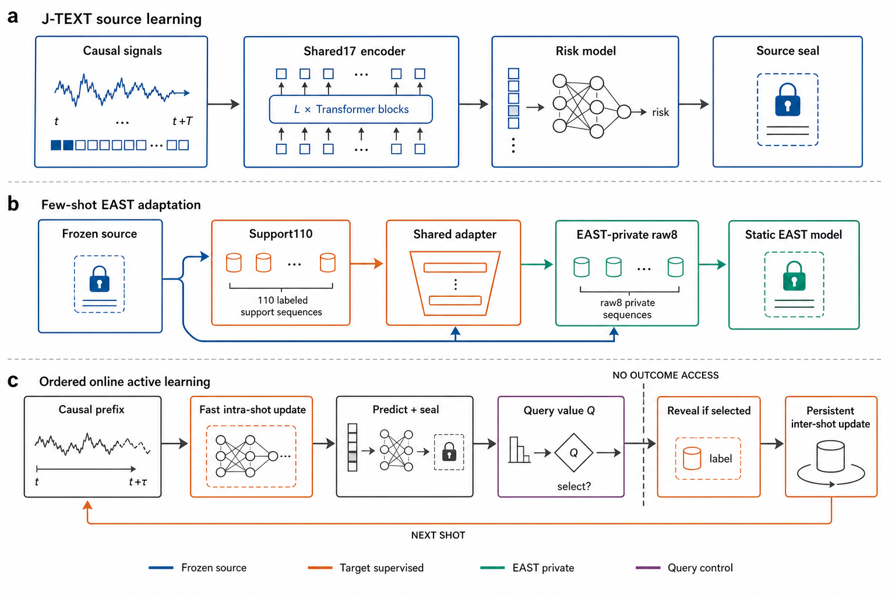

# J-TEXT → EAST：托卡马克破裂预警的因果迁移与时序在线主动适配

**默认语言：简体中文** · [English](README_EN.md) · [详细中文说明](README_CN.md)

[动态主线技术报告](experiments/transfer_methods_2026/paper_grade_package/DYNAMIC_MAINLINE_TECHNICAL_REPORT_zh.md) · [XeLaTeX 源码](experiments/transfer_methods_2026/paper_grade_package/technical_report_dynamic/main.tex) · [实现细节](IMPLEMENTATION_DETAILS_CN.md) · [数据合同](DATA_CONTRACT.md)

   
  




本仓库实现一条可审计的托卡马克破裂预警研究链：

```text
J-TEXT TRAIN1353 源模型
→ EAST support110 小样本迁移
→ EAST balanced360 静态封存
→ 重置到同一迁移后父模型
→ balanced360 按炮号顺序在线主动适配
```

J-TEXT TEST220 还运行一条独立在线诊断支路；该支路的在线参数**禁止**进入 EAST 迁移。所有整炮结局与破裂时刻只由 HDF5 `/meta/IsDisrupt` 和 `/meta/DownTime` 定义。

> 证据边界：当前状态为 `TEST_DRIVEN_EXPLORATION` / `DEVELOPMENT_EVIDENCE_NOT_INDEPENDENT_CONFIRMATION`。TEST220 与 balanced360 均参与方法开发，不是独立未来确认集，也不是装置部署成绩。

## 当前动态主线结果

以下是 seeds 131/133/137 的等权均值。TPR 是满足提前量规则的 operational TPR；J-TEXT 要求 lead $>10$ ms，EAST 要求 lead $\geq30$ ms。

| 阶段 | TPR | FPR | AUC | $J=\mathrm{TPR}-\mathrm{FPR}$ |
|---|---:|---:|---:|---:|
| J-TEXT static TEST220 | **0.866667** | **0.130303** | **0.967906** | **0.736364** |
| EAST static balanced360 | **0.824074** | **0.142593** | — | **0.681481** |
| EAST online balanced360 | **0.824074** | **0.142593** | — | **0.681481** |

恢复原 support110 炮优先采样器和原 v3c 在线配置后，EAST static 与 online 的三 seed 平均指标相同，平均 $\Delta J=0$。逐 seed 有小幅正负变化但相互抵消，因此不能宣称稳定在线增益；seed133 的 TPR 低于 0.80，故 `T0_ADMITTED=false`。J-TEXT 20% full-active 的三 seed $\Delta J$ 为 0、−0.009091、0，因此 `ONLINE_SUPPORTED=false`。

EAST 在线 $\Delta J$ 按 seed 分别为 $-0.005556、+0.005556、0$；对应查询 103、100、97 炮。这里保留的是原方法的真实结果，没有为了制造增益而修改采样、查询、更新或报警规则。

这些值已由证据装配脚本从逐炮封存预测和 HDF5 真值重新计算；紧凑证据报告包含 80 个输入产物哈希，当前 SHA-256 为 `35915b782b6c247ff768e643d02d370f4776586fab10ce54f9f8c1305a9cdbff`。文档与该报告不一致时必须失败关闭。

## 当前标签合同

J-TEXT 破裂炮正样本上界为

$$
H_s^J=\max(25\ \mathrm{ms},\mathrm{AdvancedTime}_s),
$$

AdvancedTime 缺失时取 25 ms。EAST support110 仍使用固定 125 ms 上界。AdvancedTime 只改变窗口上界，不覆盖 HDF5 结局或 DownTime。当前臂名称为 `source_dynamic__east_fixed`。

## 方法概览

- **源模型**：$128\times17$ 因果窗；patch 8/stride 8；两层 4 头 Transformer，$d_{\text{model}}=64$。
- **跨装置输入**：shared17 使用 J-TEXT TRAIN1353 的 median/IQR scaler；EAST 不重拟合共享 scaler。
- **EAST 私有输入**：8 个不适合强制同义对齐的通道形成 48 维因果摘要，进入有界目标残差支路。
- **小样本迁移**：冻结低层，只适配最后一层 Transformer、LayerNorm、独立 EAST head、共享动态与私有残差。
- **炮内更新**：每炮创建 fast 副本，只使用当前及过去端点做无标签适配；炮后丢弃。
- **炮间更新**：整炮预测和查询先封存；只有被选择炮才揭示标签并更新 persistent，失败时事务回滚。
- **报警**：任一因果端点满足冻结状态机即可，不要求连续 10 点；过早报警另行审计。

损失、查询价值、每个变量定义和公式—代码映射见[动态主线技术报告](experiments/transfer_methods_2026/paper_grade_package/DYNAMIC_MAINLINE_TECHNICAL_REPORT_zh.md)。

## 快速复现

### 1. 环境和数据

统一使用带 CUDA 的 `rl_env`：

```bash
export FUSION_DATA_ROOT=/absolute/path/to/data
PY=${CONDA_PREFIX}/bin/python

$PY -c 'import torch,h5py; print(torch.__version__); print(torch.cuda.is_available()); print(torch.cuda.get_device_name(0))'
```

公共 CPU CI 只安装合同审计依赖，不替代 GPU 训练或在线回放：

```bash
uv sync --frozen --only-group ci --no-install-project
```

GPU 开发环境保持在当前 Conda 环境中：

```bash
UV_PROJECT_ENVIRONMENT="$CONDA_PREFIX" uv sync --frozen --extra dev
export FUSION_PROJECT_ROOT="$PWD"
```

`fusion-reproduce` 是完整 checkout 的 editable CLI；本项目并不发布一个可脱离仓库独立运行的 wheel。它仍需要 `FUSION_PROJECT_ROOT` 指向的仓库配置、炮表和脚本。

数据目录：

```text
data/
├── J-TEXT/unified_hdf5/<shot//100*100>/<shot>.hdf5
└── EAST/unified_hdf5/<shot//100*100>/<shot>.hdf5
```

原始 HDF5 不提交到 Git。高频运行输出建议写入 ext4；不要把大量逐端点账本写到存在稳定性问题的 NTFS 路径。

### 2. 三 seed 动态主线

```bash
for seed in 131 133 137; do
  $PY experiments/transfer_methods_2026/run_selected_full_mainline.py \
    --seed "$seed" \
    --stage all \
    --data-root "$FUSION_DATA_ROOT" \
    --output "/ext4/runs/selected_full_mainline/seed${seed}"
done
```

固定阶段顺序为 `source-train → jtext-static → jtext-online → east-parent → east-static → east-online`。`jtext-online` 是独立诊断分支；`east-parent` 仍只读取同 seed 的**原始静态 J-TEXT checkpoint**，禁止读取 J-TEXT 在线状态。

### 3. J-TEXT 在线诊断

```bash
for seed in 131 133 137; do
  $PY experiments/transfer_methods_2026/run_jtext_online_active.py \
    --seed "$seed" \
    --arm full_active \
    --budget 20 \
    --data-root "$FUSION_DATA_ROOT" \
    --source-checkpoint "/ext4/runs/selected_full_mainline/seed${seed}/source-train/source_checkpoint.pt" \
    --output "/ext4/runs/jtext_online_v2/seed${seed}/full_active_b20"
done
```

### 4. 报告、测试与最终证据核验

```bash
$PY experiments/transfer_methods_2026/paper_grade_package/scripts/build_dynamic_report.py --check-only
$PY experiments/transfer_methods_2026/paper_grade_package/scripts/build_dynamic_report.py
$PY -m pytest -q tests/experiments/test_dynamic_mainline_report.py
```

报告构建器会拒绝活动文档混入旧 archived-parent 主结果，并生成文件 SHA-256 清单。证据装配与整仓合同测试必须同时通过；文档数值不得代替机器证据。

## 数据访问顺序

在线每炮必须遵守：

```text
predict
→ endpoint/shot seal
→ query decision seal
→ reveal selected outcome only
→ update or rollback
→ next shot
```

当前炮的 `IsDisrupt`、`DownTime`、AdvancedTime 和未来端点在当前炮预测时不可达。未查询炮的结局不能进入参数更新或表型记忆。

## 仓库主线文件

```text
experiments/transfer_methods_2026/
├── train_jtext_source_transformer.py
├── run_selected_full_mainline.py
├── run_unified_online_active.py
├── jtext_online_adapter.py
├── run_jtext_online_active.py
└── paper_grade_package/
    ├── DYNAMIC_MAINLINE_TECHNICAL_REPORT_zh.md
    ├── technical_report_dynamic/main.tex
    ├── configs/primary_chain_dynamic_source_v1.json
    ├── configs/jtext_online_active_v1.json
    └── scripts/build_dynamic_report.py
```

## 历史结果隔离

旧 paper-v3c archived-parent 材料只作为历史归档，不是本分支默认结果。活动 README 和动态报告不再混写旧主结果；若需要复核历史实验，应在独立归档入口中明确标注其 checkpoint、标签和报警口径。

## 许可证与引用

许可证见 [LICENSE](LICENSE)，引用元数据见 [CITATION.cff](CITATION.cff)。提交论文或向技术部门交付前，仍须补充独立未来流确认；当前机器证据、产物哈希和版本 SHA 已固化在动态主线包中。
