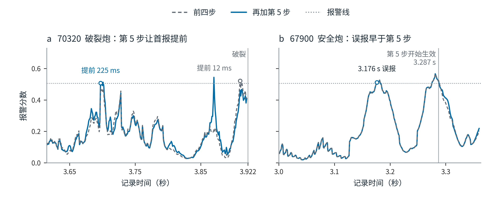

# J-TEXT → EAST：托卡马克破裂预警的因果迁移与时序在线主动适配

**语言 / Language：** **简体中文（默认）** · [English](README_EN.md)

## 让 EAST 在破裂前多留一点反应时间

EAST 是一台用磁场约束高温等离子体的聚变实验装置，一次放电简称“一炮”。等离子体突然失稳、发生破裂时，装置可能承受很大的热负荷和机械载荷。预警的价值不仅是“报没报”，更是**能否给保护系统留出时间，同时少误报正常放电**。

本研究先用另一台装置 J-TEXT 的历史数据训练模型，再让它适应 EAST。关键想法是：**先预测接下来的仪器读数，等实测到达后，利用猜错的地方修正本炮后续的判断。** 当前炮还没有结束，不需要提前知道它会不会破裂。

> **360 炮历史开发回放：** 及时检出 **146/180（81.11%）**，误报 **34/180（18.89%）**。相对准备后的静态基线，前四步净增 **8 炮及时**，第 5 步再增 **2 炮及时**。  
> **扩展到另外 2,593 炮：** 完整方法误报率 **27.56%**，超过 20% 上限。当前方法在 360 炮上有实测增益，大样本主阈值未达标。

研究结果更新至 **2026-11-14**；README 整理于 **2026-11-15**。

[方法怎样工作](#方法怎样工作) · [逐步贡献](#每一步贡献多少) · [双炮曲线](#70320和67900一炮早报一炮误报) · [大样本与局限](#换到更大样本为什么还不能说成功) · [代码与证据](#查看代码曲线和实验记录)

## 方法怎样工作

### 先训练，再准备 EAST，最后逐炮运行

1. **J-TEXT 离线训练。** 一个基础网络根据近期信号判断风险；一个辅助预测器估计未来仪器读数。两种输出分开：风险分数决定是否报警，读数预测用来在实测到齐后产生误差。
2. **EAST 前 20 炮准备。** 这 20 炮有 8 炮破裂、12 炮未破裂。先用原模型预测并保存，全部结束后，才对齐密度读数 `ne_nG` 的尺度、拟合 EAST 评分公式并确定后段阈值。**前 20 炮仍计入总成绩，不用准备后的模型倒回去重报。**
3. **EAST 后 340 炮运行。** 基础网络与评分公式冻结，每炮只用截至当前点的信号和已到齐的实测误差做临时修正。炮结束后清空临时状态；下一炮重新开始。

每毫秒到一个新点，模型看最近 **128 点、23 路诊断**，例如电流、环电压、位置、磁扰动和辐射。开头不满 128 点或中间缺测，就标记缺失，不用未来读数补齐。输入包含已提取的磁扰动统计量；**主方法不额外做傅里叶变换**。

```text
每个新点到达 → 用已到信号给当前时刻打分 → 越过固定报警线就报警
                     ↑
每隔32点预测未来25点 → 等25点实测到齐 → 算误差 → 只修正之后的打分
```

**主报警线从哪里来？** 前 20 炮沿用源阈值 **0.7258947**。准备结束后，对 12 个未破裂炮做留一检查：每次用其余 19 炮拟合评分，再记录留出炮的整炮最高分。主线设在这些峰值的第二高值略上方，为 **0.5062586**。后 340 炮所有主表对照共用这条线，不按各炮结局改线。较严的 **0.6766528** 只用于单列核对，不混入主成绩。

### 前四步处理评分和输入，第 5 步处理网络内部

“步骤”表示**累加开启的处理模块**，不是要求同一炮必须依次等五步结束才报警；报警始终进行。

- **第 1 步：记住最近猜错在哪里。** 实测到齐后，记录整体猜高、猜低以及误差的走势。评分公式多读取这份本炮短期记录，仪器读数的输入方式还没改。
- **第 2 步：区分常见误差和这次的异常误差。** 用同一炮较早、运行条件相近的片段估计平常的误差，再把这笔误差超出平常的部分交给评分公式。最近两笔误差方向一致时，提示的分量更大。
- **第 3 步：修正送入网络的信号走势。** 用到齐的反馈，调整磁扰、位置、电压、辐射几组信号在已观测窗口里的前后关系。只改输入副本的形状，不改原始记录或时间，也不访问窗口之后的读数。
- **第 4 步：扣掉反复出现的整体偏差。** 若某路实测总比预测高一点，就估计这个差值，在幅度限制内，从这路输入副本的有效点扣掉同样多。**第 3 步改走势，第 4 步改整体高度。**
- **第 5 步：让最新误差改变网络内部怎样比较时间段。** 前四步照常，只在第一层注意力之前加入临时修正；基础权重、风险评分公式和报警线不动。误差能使之后的分数升高，也能使它降低。

<details>
<summary>想看模型具体改在哪里：60 个临时系数，而不是重新训练整个网络</summary>

基础网络 `Simple23` 有两层 Transformer。128 点按每 8 点分成 16 个时间块，每块换成 64 维内部表示，注意力层再比较这些块。

第 5 步把 25 点预测与实测每 5 点分一段，保留五段里误差的正负和走势，再减去本炮此前已到齐的常见误差。反馈来自八路读数，归为磁扰、位置、环电压、辐射四组；把误差换成修正方向的规则在 J-TEXT 历史上拟合。

16 个块形成 15 对相邻块，每对每组有一个临时系数，共 **15×4=60 个**。系统用误差算出内部表示应朝哪个方向变，再用当前已观测窗口求出这些系数。相邻块一边加、一边减同样的量，改变段间差别；实际改动幅度受限。后续网络读取改变后的表示，给出新的风险分数。

误差可用后，主版本**额外等 5 点**，再在 8 个采样间隔内逐渐交接新旧修正。等待只延后修正生效，期间照常预测和报警；炮末清空这些系数。[实际写入代码](research/east360-online-adaptation/experiments/risk_aligned_online/commissioning_group_token_20261112.py) · [等待与回放代码](research/east360-online-adaptation/experiments/risk_aligned_online/commissioning_write_delay_20261112.py)

</details>

### 炮内和炮间不能混算

**炮内更新用本炮已到的实测，改本炮之后的判断；炮间更新用已经结束的炮，改后续炮。** 主结果采用前四步加第 5 步，不叠加准备段之后的炮间标签更新。

另做的炮间对照在本炮预测封存、炮结束后才按预算揭示结局，共 16 次；每次用已揭示的一破裂炮、一未破裂炮，各取 8 点等权，调整后续风险评分。前四步加炮间为 **145 及时、38 误报**；再加第 5 步为 **147 及时、38 误报**。两组误报均为 **21.11%**，超过主上限，未替代当前方案。

## 每一步贡献多少

固定 **360 炮：180 破裂、180 未破裂**。每炮只看首报：破裂前提前量**严格大于 30 ms**才算及时，恰好 30 ms 也算晚报；未破裂炮只要越线一次就算误报。目标是在误报 **≤20%（最多 36 炮）** 时提高及时检出。

下表每行保留上一行，只增加所列处理；成员、炮序、准备段预测和同阶段报警线相同。增量是配对回放的**净变化**，不是不同数据集的成绩。

| 累加处理 | 及时检出 / 180 | 误报 / 180 | 比上一行：及时 / 误报 |
|---|---:|---:|---:|
| 0 · 准备后静态，关闭炮内修正 | 136（75.56%） | 32（17.78%） | — |
| 1 · 评分读取本炮近期误差 | 138（76.67%） | 31（17.22%） | +2 / −1 |
| 2 · 评分再读取超出平常的误差 | 141（78.33%） | 34（18.89%） | +3 / +3 |
| 3 · 修正输入的前后走势 | 143（79.44%） | 34（18.89%） | +2 / 0 |
| 4 · 输入再扣除持续整体偏差 | 144（80.00%） | 34（18.89%） | +1 / 0 |
| **5 · 最新误差修正第一层内部表示，等 5 点** | **146（81.11%）** | **34（18.89%）** | **+2 / 0** |

**前四步合计：** 相对静态净增 **8 炮及时（+4.44 个百分点）**、净增 **2 炮误报（+1.11 个百分点）**。144 这一行已有炮内处理，**不是静态基线**。第 3 步虽然误报总数不变，实际去掉一炮、又新增一炮。

**第 5 步独立贡献：** 将 **70320、73405** 从晚报改为及时，净增 **2 炮（+1.11 个百分点）**，误报仍是同样的 34 炮。完整方法相对静态共多 **10 炮及时**，不是这 10 炮都由第 5 步救回。

按“及时的破裂炮 + 未误报的未破裂炮”除以 360，总体准确率依次为：**静态 78.89% → 前四步 80.56% → 完整 81.11%**。完整方法另有 **22 炮晚报、12 炮未报**。若晚报也算对，三者准确率都为 **87.22%**，看不出提前报警的价值。

[完整 13 行计分与准确率](research/east360-online-adaptation/outputs/east360_row5_70320/EAST360_完整计分.csv) · [逐炮翻转及误报名单](research/east360-online-adaptation/EAST360_TECHNICAL_EVIDENCE_20261114.md#2-每一行对照多了什么改了哪些炮)

## 70320和67900：一炮早报，一炮误报



灰虚线为前四步，蓝线再加第 5 步，水平点线为同一报警线。左图竖线是破裂时刻，右图竖线是第 5 步首次实际改动。曲线取自封存回放，不是示意数据。

### 70320：3.639 秒预测，实测到齐后才改，3.697 秒早报

模型在 **3.639 s** 发出对 **3.640–3.664 s** 的预测；实测逐点到齐后，从 **3.665 s** 才允许计算整笔误差。有一路位置读数前半段低于预测、后半段又高于预测，分段误差保留了这种转向，不让一高一低在整体均值中抵消。

等 5 点后，**3.670 s** 开始交接，**3.671 s** 混入新修正，**3.678 s** 完成交接。到 **3.697 s**，前四步分数 **0.47423**，完整方法 **0.50769**，刚越过 **0.5062586**。改变的是网络看到的段间差别，报警线没移动。

该炮在 **3.922 s** 破裂。前四步 **3.910 s** 首报，只提前 **12 ms**；第 5 步后 **3.697 s** 首报，提前 **225 ms**，多出 **213 ms**。用同样幅度但较早的误差，此时分数为 **0.4601**，未越线：这个案例显示最新实测的方向确实影响了早报。

**限制也要看：** 70320 首次仅一个点越线；要求连续两点确认时，它不再算及时。另一新增及时炮 73405 从 **29 ms → 33 ms**，只比及时界线多 3 ms，而且较早误差对照也能救回它。

### 67900：3.176 秒已经误报，3.287 秒才首次改动

67900 **没有破裂**，但两个版本都在 **3.176 s** 误报。第 5 步首次实际改动在 **3.287 s**，晚了 **111 ms**，后到反馈不能撤销已发出的警报。

**不是整炮太短，而是报警来得太早、反馈条件还没凑齐。** 这炮记录约 5 秒，从 **3.000 s** 开始；误报时只经过 176 ms。**3.127 s** 的首笔预测缺足够的历史参照。**3.159、3.191、3.223 s** 的合格预测逐步积累参照，到 **3.255 s** 发出的那笔才满足最新/较早误差公平对照的共同写入条件。它的实测 **3.280 s** 收齐，**3.281 s** 允许用误差，再等 5 点并交接，下一点 **3.287 s** 才实际改变模型。

分步回放中，第 2 步使这炮在 **3.281 s** 误报，第 3 步又把首报提前到 **3.176 s**。这个错例说明，早期评分和输入修正本身也需要改进，不能把问题全归给最后一步。

**多等 5 点的实测作用：** 70320 等不等均在 3.697 s 首报；未破裂炮 **73743** 不等时在 4.698 s 误报，等后整炮未报。360 炮中，等待使 **146 及时 / 35 误报 → 146 / 34**，及时炮号不变；这一交接效果仍需按现场实际延迟验证。

[双炮绘图数据 CSV](research/east360-online-adaptation/outputs/east360_technical_20261114/two_shot_curves.csv) · [Python / seaborn 脚本](research/east360-online-adaptation/outputs/east360_technical_20261114/plot_two_shots.py) · [矢量 PDF](research/east360-online-adaptation/outputs/east360_technical_20261114/two_shot_timelines.pdf) · [70320 实测与内部变化](research/east360-online-adaptation/outputs/east360_row5_70320/70320_mechanism.pdf)

## 怎样防止提前看到答案，怎样做样本均衡

- **按到达时点用数据。** 当前判断只能用当前及更早的读数；25 点实测到齐前不能训练这笔反馈；临时状态炮末重置。预测封存后，炮结束才揭示结局。主方法不拿后 340 炮结局重新拟合评分或阈值。
- **训练、准备与评分分开。** J-TEXT 固定分为 1,353 炮训练、160 炮验证、220 炮测试；训练拟合模型，验证选择源模型与阈值。EAST 只有前 20 炮用于准备后段运行；原预测保留。
- **结局只认原始 HDF5。** `meta/IsDisrupt` 判断是否破裂；只有破裂炮的 `meta/DownTime` 用作破裂时刻，不从炮表或事件表补判。EAST 破裂前 **125 ms** 是训练正窗，**>30 ms** 是及时评分规则，二者不同。
- **训练不让长炮或多数类占便宜。** 准备段评分拟合中，正负时间点各分一半权重，同类内按炮等权；炮间对照每次正负各一炮、各 8 点等权。完整评价保留两类各 180 炮，所有错例都计入。

两例新增及时炮的首报已做截断重放：删掉首报之后的信号，已有判定不变。[截断检查记录](research/east360-online-adaptation/probe_outputs/commissioning_first_alarm_witness_east360_20261113_v1/prefix_at_first_alarm.json)

**数据限制：** 360 炮已参与方法开发和选型，上述因果访问检查不会使它变成独立测试集。固定回放顺序也不等于已认证的真实采集日期顺序；上游诊断计算和现场数据到达时标尚未独立认证。

## 换到更大样本，为什么还不能说成功

额外 **2,593 炮历史放电**包含 1,018 炮破裂、1,575 炮未破裂，沿用原模型和主阈值，未为扩展样本重新拟合。

| 相同主阈值的扩展对照 | 及时检出 / 1,018 | 误报 / 1,575 |
|---|---:|---:|
| 准备后静态 | 695（68.27%） | 367（23.30%） |
| 前四步 | 697（68.47%） | 420（26.67%） |
| 完整方法 | 706（69.35%） | 434（27.56%） |

第 5 步净增 **9 炮及时**，也净增 **14 炮误报**，没有满足“误报 ≤20% 下提高及时检出”的主要求。静态误报已达 **23.30%**，说明问题不只在第 5 步。抽成两类各 **833 炮**后，完整方法仍误报 **230/833（27.61%）**，不是把类别数量配平就能解决。

回到 360 炮，34 个误报中，**6 炮在准备段、7 炮在第 5 步首次实际改动之前、21 炮在其生效后**；最后这 21 炮关掉第 5 步也会误报。完整方法没有新增误报炮，但个别首报时刻会变化。[误报逐炮时刻、分数与分类](research/east360-online-adaptation/outputs/east360_row5_70320/EAST360_误报逐炮.csv)

其它扩展也没有替代主方法：在同一 360 炮上，时域特征为 **147 及时 / 42 误报（23.33%）**，傅里叶频带为 **149 / 41（22.78%）**；加入其它信号确认后，电流确认 **146 / 36（20.00%）**、三诊断确认 **147 / 39（21.67%）**。没有同时增加及时并保持误报在上限内，当前方案不加入这些分支。[完整负结果与对照](research/east360-online-adaptation/EAST360_TECHNICAL_EVIDENCE_20261114.md#4-其它路线解决了什么没解决什么)

较严阈值和连续确认的核对也保留在[实验明细](research/east360-online-adaptation/EAST360_TECHNICAL_EVIDENCE_20261114.md#3-第-5-步的模型动作时钟和敏感性)，不拿较低误报档替换主阈值结论。扩展炮也是历史数据，仍缺**从未参与选型的新 EAST 炮流**和**现场实际延迟**。下一阶段应先冻结版本，在新炮上只记录、不接管设备，同时比较前四步与完整方法。

## 查看代码、曲线和实验记录

想看研究本身，不需要 GPU：

- **看方案与讲解：** [技术方案](research/east360-online-adaptation/EAST360_TECHNICAL_PROPOSAL_20261114.md) · [可直接照着讲的汇报稿](research/east360-online-adaptation/EAST360_TECHNICAL_TALK_20261114.md)。
- **看全部炮，而不只看两个案例：** [360 炮曲线图谱，约 64 MB](research/east360-online-adaptation/outputs/east360_row5_70320/EAST360_逐炮图谱.pdf) · [计分 CSV](research/east360-online-adaptation/outputs/east360_row5_70320/EAST360_完整计分.csv) · [误报 CSV](research/east360-online-adaptation/outputs/east360_row5_70320/EAST360_误报逐炮.csv)。
- **看代码：** [前四步输入与内部计算入口](research/east360-online-adaptation/experiments/risk_aligned_online/commissioning_layer_transport_20261112.py) · [第 5 步系数与误差](research/east360-online-adaptation/experiments/risk_aligned_online/commissioning_group_token_20261112.py) · [等待和回放](research/east360-online-adaptation/experiments/risk_aligned_online/commissioning_write_delay_20261112.py)。
- **查完整实验：** [实验明细](research/east360-online-adaptation/EAST360_TECHNICAL_EVIDENCE_20261114.md) · [工程实验总账](research/east360-online-adaptation/EAST_PHYSICS_CONDITIONED_ADAPTATION_DESIGN_20261111.md) · [当前研究状态](research/east360-online-adaptation/CURRENT_SOURCE_UPDATE_STATE_20261104.md)。

```bash
git clone --branch research/east360-online-adaptation \
  https://github.com/rikfish163-rgb/tokamak-final.git
cd tokamak-final/research/east360-online-adaptation
```

已有 NumPy、matplotlib、seaborn 的环境可从打包数据重画双炮图：

```bash
python outputs/east360_technical_20261114/plot_two_shots.py
```

使用项目现有 `rl_env` 可运行 CPU 定向测试：

```bash
PYTHONDONTWRITEBYTECODE=1 CUDA_VISIBLE_DEVICES='' python -m pytest -q -p no:cacheprovider \
  tests/test_commissioning_write_delay_20261112.py \
  tests/test_commissioning_group_carry_20261112.py
```

**完整模型重放还需要外部资产。** 原始 HDF5、模型权重和输入缓存未随 Git 上传；原路径与封存协议列在[外部资产说明](research/east360-online-adaptation/EXTERNAL_ASSETS.md)。已有曲线和成绩可直接查看，不能把读取这些文件称为一次新的模型实验。[同步清单](research/east360-online-adaptation/SYNC_MANIFEST.json) · [同步核对记录](research/east360-online-adaptation/SYNC_VALIDATION.md) · [MIT 许可证](LICENSE)

本研究是 **J-TEXT 基础模型 → EAST 准备段 → 逐炮炮内适配**。旧 support110／V3C 另有分集、处理和阈值，保留为历史资料，成绩不混报。

---

<details>
<summary>历史路线：support110 / V3C 的原仓库说明（与本研究分开）</summary>

## 原仓库历史路线说明

**语言 / Language：** **简体中文（默认）** · [English](README_EN.md)

[代码级方法细节](IMPLEMENTATION_DETAILS_CN.md) · [复现与部署](#cn-quickstart) · [论文级实验包](experiments/transfer_methods_2026/paper_grade_package/README.md) · [数据合同](DATA_CONTRACT.md) · [中文技术报告 PDF](experiments/transfer_methods_2026/paper_grade_package/TECHNICAL_REPORT_zh.pdf)

[2026-08-31 当前工作树主线增量与结果索引](docs/research/current_mainline_20260831_cn.md)（与 paper-v3c archived-parent 证据分列）

[](https://github.com/rikfish163-rgb/tokamak-final/actions/workflows/ci.yml)


> 面向 J-TEXT → EAST 跨装置破裂预警研究的可复现仓库。主线覆盖源域因果 Transformer、小样本目标迁移、EAST 私有信号适配，以及严格按炮序执行的在线主动学习；结局与破裂时刻以 HDF5 为唯一权威，并保存预测、封存、查询、揭示和更新账本。
>
> **证据边界：** 当前结果属于 `DEVELOPMENT_EVIDENCE_NOT_INDEPENDENT_CONFIRMATION`。`balanced360` 是方法开发流，不是独立最终测试集，也不构成装置部署确认。

<a id="cn-toc"></a>
## 目录

- [项目范围与状态](#cn-scope)
- [架构与因果协议](#cn-architecture)
- [主线是怎样工作的](#cn-method-details)
- [三阶段结果](#cn-results)
- [部署与复现](#cn-quickstart)
- [数据合同](#cn-data-contract)
- [可复现合同](#cn-reproducibility)
- [证据映射](#cn-evidence-map)
- [已完成的开发控制](#cn-completed-controls)
- [未来独立确认封存](#cn-prospective-seal)
- [限制与结论边界](#cn-limitations)
- [仓库结构](#cn-layout)
- [引用与许可证](#cn-citation)

<a id="cn-scope"></a>
## 项目范围与状态

本 checkout 打包的是一条可追溯链路：

```text
J-TEXT 源域拟合
→ EAST support110 小样本迁移
→ EAST balanced360 静态评估
→ 重置到同一个迁移后父模型
→ 按炮号顺序进行 balanced360 在线主动回放
```

这条链路用于可审计的方法开发。`balanced360` 曾参与架构开发和 972 个候选参数筛选，因此其静态和在线指标不能被表述为未使用过的测试集、独立未来实验或部署结果。当前默认 CLI 是 paper **v3c archived-parent replay**；历史 v8 不属于最终论文谱系发布合同。

所有结局和破裂时间标签均来自 HDF5 `/meta/IsDisrupt` 与 `/meta/DownTime`。论文级实验包、机器证据、图和 readiness 审计集中在[论文级实验包](experiments/transfer_methods_2026/paper_grade_package/README.md)。

<a id="cn-architecture"></a>
## 架构与因果协议

下图概括实际执行的三阶段架构；损失函数、生效/影子分支和更新顺序仍以
[代码级实现说明](IMPLEMENTATION_DETAILS_CN.md)与仓库代码为准：


独立的数据 roster 与信息访问协议见[协议图](experiments/transfer_methods_2026/paper_grade_package/figures/fig1_protocol_and_causal_contract.svg)。

在线合同是：

```text
predict → seal → query → 揭示被选炮的结局 → 后续炮更新
```

当前炮的结局不能进入当前炮的预测。EAST 静态评估先完成并封存，在线分支随后重置到相同的迁移后父模型，因此在记录的谱系内两个 EAST 分支是阶段隔离的。

<a id="cn-method-details"></a>
## 主线是怎样工作的

主线不是把 23 个信号直接拼起来做一次普通微调，而是把跨装置共享信息和
EAST 私有信息分开处理：

1. J-TEXT Transformer 只学习经过单位修复和物理重构的 shared17；
2. support110 只微调最高一层 Transformer、LayerNorm 和独立 EAST head，随后
   拟合有界 shared dynamics residual 与 raw8 EAST-private residual；
3. 每炮开始把 persistent 适配器复制成 fast 模型，炮内只用已经到达的下一状态、
   fast/slow 一致性和物理矛盾做无标签更新，fast 在炮后丢弃；
4. 整炮预测封存后，由“报警边界不确定性 + 模型/物理矛盾”价值函数配合滚动
   token 预算决定是否查询。只有被选炮才打开 HDF5 标签，并用部署一致的 MIL
   报警损失更新 persistent 模型；若伤害任一已知正确 guard，整次更新回滚。

风险 logit 的残差如何叠加、每个损失的公式、窗口价值如何换算成学习率、查询
cutoff 如何形成、FP/FN/TARDY 如何改变报警参数，以及哪些代码虽存在但在 v3c
中权重为零，均在[代码级实现说明](IMPLEMENTATION_DETAILS_CN.md)中逐项展开。主线
文件清单由 [`config/mainline_code_manifest.json`](config/mainline_code_manifest.json)
机器校验，避免发布时漏掉间接依赖。

<a id="cn-results"></a>
## 三阶段结果

以下是当前论文级谱系维护的三 seed 均值。正式 TPR 只统计满足对应提前量规则的告警；EAST `lead<30 ms` 的告警在正式口径中计为 operational false negative。当前三阶段表只在 J-TEXT 源域阶段报告 AUC。

| 阶段 | 评估角色 | Operational TPR | FPR | AUC | Operational 中位提前量 |
|---|---|---:|---:|---:|---:|
| J-TEXT source | 非时序 TEST220 比较集，lead `>10 ms` | 0.8515 | 0.2121 | 0.9219 | 116.6 ms |
| EAST static | support110 迁移后的 balanced360，lead `≥30 ms` | 0.8407 | 0.1667 | — | 242.0 ms |
| EAST online active | 重置到同一迁移后父模型，按时间顺序回放 balanced360，lead `≥30 ms` | 0.8481 | 0.1519 | — | 229.5 ms |

这张表是开发流证据，不是前瞻性泛化结论。早于 3 s 的告警仍按已注册合同保留资格，并单独审计；raw alarm occurrence 只作为机器证据字段，不提升为第二个主结果。

<a id="cn-quickstart"></a>
## 部署与复现

以下命令面向一台配有 NVIDIA GPU 的 Linux 工作站。论文主线使用 Python 3.11、
CUDA 版 PyTorch 和名为 `rl_env` 的 Conda 环境；CPU 公共 CI 只验证合同、证据构建
与合成控制器测试，不替代 GPU 回放。

### 0. 获取代码并固定版本

```bash
git clone https://github.com/rikfish163-rgb/tokamak-final.git
cd tokamak-final
git status --short --branch
```

正式复现应记录具体 commit SHA；不要在一次多 seed 回放中途切换分支、修改配置或
替换 HDF5 文件。

### 1. 环境与数据

使用项目 `rl_env` 环境。原始 HDF5 数据可以放在 checkout 下的 `data/`，也可以通过 `FUSION_DATA_ROOT` 指向外部目录：

公共 CI 的 CPU 单元测试/审计环境使用独立锁定组，不安装 CUDA 项目运行时：

```bash
uv sync --frozen --only-group ci --no-install-project
```

GPU 训练和回放统一使用带 CUDA 的 `rl_env`。本仓库本身才是复现产物，
并不发布一个可脱离仓库独立运行的 wheel；`fusion-reproduce` 仅指从完整
checkout editable 安装得到的入口，仍需完整仓库，或用
`FUSION_PROJECT_ROOT` 显式指向它，因为冻结脚本、checkpoint、划分合同和参考
结果不在 Python 包内部。

```bash
export FUSION_DATA_ROOT=/absolute/path/to/data

data/
├── J-TEXT/unified_hdf5/<shot//100*100>/<shot>.hdf5
└── EAST/unified_hdf5/<shot//100*100>/<shot>.hdf5
```

原始 HDF5 不随 Git 提交。生成的账本最好写入 ext4 路径；部分 `ntfs3` 挂载点上的高频 `fsync` 可能阻塞。

先确认使用的确实是 `rl_env` 中的 Python、PyTorch 与 GPU：

```bash
conda run -n rl_env python -c \
  'import sys,h5py,torch; print("python:",sys.version); print("h5py:",h5py.__version__); print("torch:",torch.__version__); print("cuda_available:",torch.cuda.is_available()); print("cuda_device:",torch.cuda.get_device_name(0) if torch.cuda.is_available() else None); raise SystemExit(0 if torch.cuda.is_available() else 2)'
```

若是新机器，可先创建 Python 3.11 的 `rl_env`，再按本仓库的 `uv.lock` 同步依赖；
已有论文工作站环境不要在回放前临时升级 PyTorch 或 CUDA：

```bash
conda create -n rl_env python=3.11 -y
eval "$(conda shell.bash hook)"
conda activate rl_env
python -m pip install uv
UV_PROJECT_ENVIRONMENT="$CONDA_PREFIX" uv sync --frozen --extra dev
```

这里显式把 `UV_PROJECT_ENVIRONMENT` 指向激活后的 Conda 前缀，避免又创建一套
与 `rl_env` 并存的 `.venv`。无论采用哪一种环境管理方式，执行主线命令时都应
固定同一个 Python 解释器并在运行清单中记录版本。

### 2. 数据预检

轻量审计检查目录、炮表和必要字段；完整审计还会逐炮打开 HDF5。若需要跨机器
核对原始数据，可额外生成内容哈希清单：

```bash
conda run -n rl_env python -m reproducibility.cli audit \
  --data-root "$FUSION_DATA_ROOT" --full --content-hash --portable \
  --output results/generated/data_audit.json

conda run -n rl_env python -m reproducibility.cli smoke \
  --data-root "$FUSION_DATA_ROOT"
```

### 3. 不执行训练，只查看冻结的 v3c 链路

`plan` 阶段只打印 source → support → static → reset → online 的确切命令，不执行回放：

```bash
conda run -n rl_env python \
  experiments/transfer_methods_2026/paper_grade_package/scripts/reproduce_primary_chain.py \
  --seed 131 --stage plan --output-root results/reproduced-v3c
```

将 `--stage plan` 换成 `--stage all` 可从随仓库提供的、哈希绑定的 J-TEXT 源 checkpoint 和通过 fidelity 验证的 EAST 归档父模型执行一个 seed。输出目录必须是新的或为空的目录。

默认 `all` **不会重新拟合 target parent**：它使用随仓库发布并经过 fidelity
检查的 archived EAST 父状态，然后执行 static360 → reset → online360。若要从
HDF5 重新训练 J-TEXT 源模型，显式加 `--retrain-source`。参数
`--rebuild-target-current-sampler` 只用于诊断当前 sampler，不能替代归档父状态的
论文 fidelity 回放。

### 4. 运行一个 seed 或三个 seed

在完整 source checkout 中，`python -m reproducibility.cli reproduce` 和
editable 安装的 `fusion-reproduce reproduce` 都使用 paper v3c
archived-parent 路径，并与
`results/reference/paper_v3c_multiseed_summary.json` 比对：

```bash
conda run -n rl_env python -m reproducibility.cli reproduce \
  --data-root "$FUSION_DATA_ROOT" \
  --output results/reproduced-v3c \
  --seeds 131 133 137
```

只做合同审计或 GPU/参考结果 smoke 检查：

```bash
conda run -n rl_env python -m reproducibility.cli audit \
  --data-root "$FUSION_DATA_ROOT" --full \
  --output results/generated/data_audit.json
conda run -n rl_env python -m reproducibility.cli smoke \
  --data-root "$FUSION_DATA_ROOT"
```

单 seed 调试建议先用新的输出目录运行 seed 131；三 seed 正式回放再使用另一个空
目录：

```bash
conda run -n rl_env python -m reproducibility.cli reproduce \
  --data-root "$FUSION_DATA_ROOT" \
  --output results/reproduced-v3c-seed131 \
  --seeds 131

conda run -n rl_env python -m reproducibility.cli verify \
  --actual results/reproduced-v3c-seed131/multiseed_summary.json
```

输出目录已存在且非空时 CLI 会失败关闭，避免把两次运行写进同一账本。每个 seed
的关键结果在 `seed<id>/final_episode_v3/summary.json`，逐炮静态预测、在线预测、
query、reveal 和 update receipt 分别保存；最终聚合写入
`multiseed_summary.json`。

### 5. 重建并验证论文证据

以下命令会重建/检查论文包证据，需要满足数据合同并使用项目环境：

```bash
conda run -n rl_env python \
  experiments/transfer_methods_2026/paper_grade_package/scripts/build_evidence.py
conda run -n rl_env python \
  experiments/transfer_methods_2026/paper_grade_package/scripts/validate_paper_package.py
```

完整合同、回放说明和缺失确认证据见 [REPRODUCIBILITY.md](REPRODUCIBILITY.md)。

### 6. 运行仓库合同测试

```bash
conda run -n rl_env python -m pytest -q
```

测试会检查数据角色零重叠、标签只能来自 HDF5、封存顺序、主线代码清单、参考
结果比较器和未来确认 seal 等合同。测试通过说明代码与证据合同自洽，不等同于
GPU 三 seed 已重新训练完成；后者必须以真实运行目录、日志和摘要为证。

<a id="cn-data-contract"></a>
## 数据合同

- 原始输入是 `J-TEXT/unified_hdf5/` 与 `EAST/unified_hdf5/` 下的 HDF5 文件；`FUSION_DATA_ROOT` 可以指向 checkout 外部。
- 只有 HDF5 `/meta/IsDisrupt` 与 `/meta/DownTime` 定义结局和破裂时间。CSV/JSON 只提供炮表、切分元数据或审计信息，不覆盖 HDF5 真值。
- J-TEXT `TEST220` 是 110/110 的 count-aligned、非时序平衡比较集，不是严格按时间顺序或真实发生率构造的测试集。
- EAST `support110` 共 110 炮，按 HDF5 为 15 炮破裂 / 95 炮安全。它同时用于拟合目标组件和选择目标阈值，因此不存在独立 EAST 验证队列。
- `support110` 与 `balanced360` 互不重叠，但 `balanced360` 仍参与了方法开发和候选筛选。

完整字段、切分和炮表合同见 [DATA_CONTRACT.md](DATA_CONTRACT.md)；论文包的逐项说明见[论文级 README](experiments/transfer_methods_2026/paper_grade_package/README.md)。

<a id="cn-reproducibility"></a>
## 可复现合同

当前发布内容围绕以下检查组织：

1. 源域与目标域阶段使用记录中的 checkpoint 谱系。
2. EAST 静态预测先完成并封存，在线分支再重置到相同的迁移后父模型。
3. 每一炮都先封存预测和 query 决策，再揭示被选炮的结局。
4. 证据构建器从 HDF5 真值和归档告警时间重新计算标签与 J-TEXT lead，发现不一致时 fail closed。
5. 大型在线账本会针对解压后的原始字节做哈希校验；仅有提交的指标摘要不算成功复现。

当前发布范围见 [RELEASE_SCOPE.md](RELEASE_SCOPE.md)。历史 v8 不属于最终论文谱系的默认复现合同。

<a id="cn-evidence-map"></a>
## 证据映射

| 问题 | 主要证据 | 可以证明什么 |
|---|---|---|
| 在线顺序是否因果？ | [图 1](experiments/transfer_methods_2026/paper_grade_package/figures/fig1_protocol_and_causal_contract.svg)、[online artifacts](experiments/transfer_methods_2026/paper_grade_package/evidence/primary_online_artifacts/)、[validator](experiments/transfer_methods_2026/paper_grade_package/scripts/validate_paper_package.py) | 记录的 `predict → seal → query → reveal → later-shot update` 顺序 |
| 三阶段均值来自哪里？ | [three_stage_results.json](experiments/transfer_methods_2026/paper_grade_package/evidence/three_stage_results.json)、[table_three_stage.csv](experiments/transfer_methods_2026/paper_grade_package/evidence/table_three_stage.csv) | 与哈希绑定的机器结果摘要 |
| 哪些标签和炮表权威？ | [DATA_CONTRACT.md](DATA_CONTRACT.md)、[切分清单](config/splits/)、HDF5 `/meta/*` | 数据和标签谱系；CSV/JSON 不覆盖标签 |
| 投稿图是否有哈希账本？ | [figure_manifest.json](experiments/transfer_methods_2026/paper_grade_package/figures/figure_manifest.json) | 图的输入/输出 SHA-256 记录 |
| 源表示是否摆脱 shortcut？ | [source_context_shortcut_audit.json](experiments/transfer_methods_2026/paper_grade_package/evidence/source_context_shortcut_audit.json)、[图 3](experiments/transfer_methods_2026/paper_grade_package/figures/fig3_source_shortcut_and_padfix_tradeoff.svg) | 已记录的 shortcut 失败与 PADFIX 权衡，而不是“无 shortcut”结论 |
| 标签访问有哪些控制？ | [equal-label front-load 证据](experiments/transfer_methods_2026/paper_grade_package/evidence/equal_label_budget_frontload_v2/)、[图 8](experiments/transfer_methods_2026/paper_grade_package/figures/fig8_equal_label_budget_frontload_ablation.svg) | 诊断性的 selected-label/front-load 对照，不是等计算量 causal random-query 结果 |
| 主动查询是否优于因果随机日程？ | [causal random-query 证据](experiments/transfer_methods_2026/paper_grade_package/evidence/causal_random_query_online_v1/)、[图 9](experiments/transfer_methods_2026/paper_grade_package/figures/fig9_active_vs_causal_random_query.svg) | 三个 seed 上主动策略效用均高于随机均值，但实际更新尝试数不同，不能解释为 selector-only 等 FLOP 因果效应 |
| J-TEXT 迁移是否优于只用 EAST 拟合？ | [target-only 证据](experiments/transfer_methods_2026/paper_grade_package/evidence/east_target_only_v1/)、[图 10](experiments/transfer_methods_2026/paper_grade_package/figures/fig10_target_only_vs_transfer.svg) | balanced360 上迁移相对严格 EAST-only 提高净效用与提前量，同时略增 FPR；两臂容量并不完全匹配 |
| 本发布需要哪些精确原始文件？ | [可移植 HDF5 内容清单](experiments/transfer_methods_2026/paper_grade_package/evidence/required_hdf5_content_manifest.json) | 对全部2,203个必需 J-TEXT/EAST HDF5 文件记录 SHA-256，且不嵌入本机绝对路径 |
| 是否达到 Nature Portfolio 确认性或部署性结论门槛？ | [readiness 审计](experiments/transfer_methods_2026/paper_grade_package/NATURE_PORTFOLIO_READINESS.md) | 没有；当前上限是可审计的开发论文包 |
| 多方审核是否认可这个边界？ | [五方审核](experiments/transfer_methods_2026/paper_grade_package/FIVE_WAY_AUDIT.md) | 五方均通过本地包完整性、均否决确认性 readiness，并记录了已修复项 |

<a id="cn-completed-controls"></a>
## 已完成的开发控制

因果块匹配 random-query 回放已完成：seeds 131/133/137 各有三个随机日程。主动相对随机均值的 `TPR@30−FPR` 分别为 `+0.0204/+0.0093/+0.0185`，等 seed 均值为 `+0.0160`。但主动策略触发的实际错误条件化炮间更新尝试约为随机策略的 `2.21×`，所以这支持的是开发流上的完整主动机制，而不是 selector-only 等 FLOP 因果效应，也不能让 balanced360 事后变成独立确认集。

严格 EAST-only baseline 也已完成。其等 seed `TPR@30−FPR=0.6519`，J-TEXT→EAST static 为 `0.6741`；迁移提高 TPR 和提前量，也带来小幅 FPR 增加。EAST-only 会更新完整随机初始化 encoder，而迁移只更新受限目标路径，因此该对照说明目标数据可识别性和迁移增量，不是完全等容量架构消融。

seed131 的低预算 **Q30** 是 balanced360 顺序流推进时，由只使用当前/过去
无标签证据的炮级查询价值、滚动阈值、token 预算和探索机制因果选出的；只有
在选择完成后才冻结清单，让 `inter_only`、`intra+inter` 和30炮前置迁移复用
完全相同的标签身份。它不是人工预设 cohort，也不是看完360炮后的全局 top-30。
30个炮号与流位置见 [Q30 manifest](experiments/transfer_methods_2026/paper_grade_package/evidence/fixed_query_low_budget30_seed131.json)。
原始360行逐炮决策账本在 tmpfs 重启后丢失，因此 Q30 只能作为开发诊断，不能
作为可独立重放的 selector 证据。主 v3c 是另一组实验，三个 seed 分别动态查询
`102/90/99` 炮。

<a id="cn-prospective-seal"></a>
## 未来独立确认封存

balanced360 不能重新变成独立确认集，但未来实验的结局前合同已经可以执行。
先用一个与 support 拟合和确认流都互斥的新目标验证 cohort 生成并提交阈值产物；
在打开任何确认流结局前：

1. 将[未来确认模板](configs/prospective_east_confirmation.template.json)复制到
   checkout 外；
2. 替换其中 git SHA、目标验证阈值、预封存随机日程和冻结执行计划占位符；
3. 分别提供只含单列递增炮号的目标验证炮表和未来确认炮表；
4. 在干净、已提交的 checkout 上生成并复核外部 seal：

```bash
conda run -n rl_env python -m reproducibility.cli prospective-seal \
  --spec /external/preregistration.json \
  --validation-roster /external/target-validation-shots.txt \
  --roster /external/future-confirmation-shots.txt \
  --output /external/future-confirmation.seal.json

conda run -n rl_env python -m reproducibility.cli prospective-verify \
  --seal /external/future-confirmation.seal.json \
  --spec /external/preregistration.json \
  --validation-roster /external/target-validation-shots.txt \
  --roster /external/future-confirmation-shots.txt
```

工具会对既有炮重叠、验证/确认重叠、含标签或元数据的炮表、脏工作树、git SHA
不匹配、冻结产物缺失和封存后字节变化全部失败关闭。它只补齐预注册能力，并不
假装尚未获得的新未来流已经完成。

<a id="cn-limitations"></a>
## 限制与结论边界

- `balanced360` 参与了架构和 972 个候选的筛选，是方法开发流，不是未触碰过的最终测试集。
- J-TEXT `VAL160`/`TEST220` 是非时序、count-aligned 的平衡比较集，不能证明源域的前瞻性泛化。
- `support110` 同时用于目标拟合和阈值选择，不存在独立 EAST 验证队列。
- 主源父模型存在 padding/context shortcut，并未通过注册的 shortcut gate。PADFIX 通过上下文检查，但在冻结目标策略下出现负迁移。
- 没有独立、从未用于开发的按时间顺序 EAST 未来流；causal random-query 已完成，但错误触发的实际计算量不同且仍属于开发流。
- 尚未完成装置侧部署验收，包括延迟、执行器集成、故障安全和跨 campaign 运行。
- 本仓库不把当前证据表述为 Nature Portfolio-ready 的确认性结果，也不声称模型学到了所有因果破裂机制。

唯一能改变结论的下一步，是在新获得的按时间顺序 EAST 炮流上完全冻结代码、阈值、目标验证规则、静态/在线/无标签分支和等预算随机查询分支，并在揭示结局前完成封存。不要在当前 `balanced360` 上继续调参来改变上述边界。

<a id="cn-layout"></a>
## 仓库结构

```text
reproducibility/                                       # 数据审计与 v3c 回放 CLI
experiments/transfer_methods_2026/paper_grade_package/ # 论文、图、账本与验证器
IMPLEMENTATION_DETAILS_CN.md                            # 损失、价值函数和更新顺序
config/mainline_code_manifest.json                     # 主线代码/父状态机器清单
config/splits/                                          # 固定的 J-TEXT/EAST 切分合同
splits/                                                 # 可读的 J-TEXT 炮号清单
results/reference/                                      # 小型参考摘要
tests/                                                  # 复现与实验合同测试
```

<a id="cn-citation"></a>
## 引用与许可证

仓库引用元数据见 [CITATION.cff](CITATION.cff)。当前 checkout 声明使用 [MIT 许可证](LICENSE)。本 README 不编造 DOI、不添加作者名单，也不把证据升级为部署或 Nature Portfolio-ready 结论；最终作者、机构、版本和 DOI 元数据须由维护者提供。

</details>
