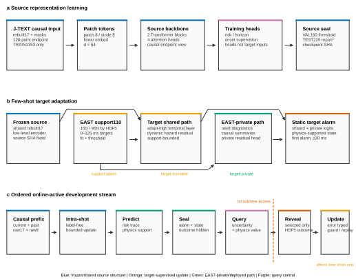

# J-TEXT → EAST：因果迁移与按时间顺序在线适配

[English](README.md) · [正式中文技术报告（LaTeX 工程）](experiments/transfer_methods_2026/paper_grade_package/technical_report_zh/README.md) · [审计正文（Markdown）](experiments/transfer_methods_2026/paper_grade_package/TECHNICAL_REPORT_zh.md) · [正式排版 PDF](experiments/transfer_methods_2026/paper_grade_package/TECHNICAL_REPORT_zh.pdf) · [论文级实验包](experiments/transfer_methods_2026/paper_grade_package/README.md) · [数据合同](DATA_CONTRACT.md)


> 这是一个以可复现和可审计为中心的研究包，用于 J-TEXT → EAST 因果迁移与按时间顺序的在线适配；标签以 HDF5 为权威，并保留封存后的 query/reveal 账本。
>
> 当前证据上限：`DEVELOPMENT_EVIDENCE_NOT_INDEPENDENT_CONFIRMATION`。`balanced360` 是方法开发流，不是独立最终测试或部署确认。

<a id="cn-toc"></a>
## 目录

- [项目范围与状态](#cn-scope)
- [架构与因果协议](#cn-architecture)
- [三阶段结果](#cn-results)
- [快速开始](#cn-quickstart)
- [数据合同](#cn-data-contract)
- [可复现合同](#cn-reproducibility)
- [证据映射](#cn-evidence-map)
- [已完成的开发控制](#cn-completed-controls)
- [未来独立确认封存](#cn-prospective-seal)
- [限制与结论边界](#cn-limitations)
- [仓库结构](#cn-layout)
- [引用与许可证](#cn-citation)

<a id="cn-scope"></a>
## 项目范围与状态

本 checkout 打包的是一条可追溯链路：

```text
J-TEXT 源域拟合
→ EAST support110 小样本迁移
→ EAST balanced360 静态评估
→ 重置到同一个迁移后父模型
→ 按炮号顺序进行 balanced360 在线主动回放
```

这条链路用于可审计的方法开发。`balanced360` 曾参与架构开发和 972 个候选参数筛选，因此其静态和在线指标不能被表述为未使用过的测试集、独立未来实验或部署结果。当前默认 CLI 是 paper **v3c archived-parent replay**；历史 v8 不属于最终论文谱系发布合同。

所有结局和破裂时间标签均来自 HDF5 `/meta/IsDisrupt` 与 `/meta/DownTime`。论文级实验包、机器证据、图和 readiness 审计集中在[论文级实验包](experiments/transfer_methods_2026/paper_grade_package/README.md)。

<a id="cn-architecture"></a>
## 架构与因果协议

下图直接展示实际执行的模型架构：



独立的数据 roster 与信息访问协议见[协议图](experiments/transfer_methods_2026/paper_grade_package/figures/fig1_protocol_and_causal_contract.svg)。

在线合同是：

```text
predict → seal → query → 揭示被选炮的结局 → 后续炮更新
```

当前炮的结局不能进入当前炮的预测。EAST 静态评估先完成并封存，在线分支随后重置到相同的迁移后父模型，因此在记录的谱系内两个 EAST 分支是阶段隔离的。

<a id="cn-results"></a>
## 三阶段结果

以下是当前论文级谱系维护的三 seed 均值。正式 TPR 只统计满足对应提前量规则的告警；EAST `lead<30 ms` 的告警在正式口径中计为 operational false negative。当前三阶段表只在 J-TEXT 源域阶段报告 AUC。

| 阶段 | 评估角色 | Operational TPR | FPR | AUC | Operational 中位提前量 |
|---|---|---:|---:|---:|---:|
| J-TEXT source | 非时序 TEST220 比较集，lead `>10 ms` | 0.8515 | 0.2121 | 0.9219 | 116.6 ms |
| EAST static | support110 迁移后的 balanced360，lead `≥30 ms` | 0.8407 | 0.1667 | — | 242.0 ms |
| EAST online active | 重置到同一迁移后父模型，按时间顺序回放 balanced360，lead `≥30 ms` | 0.8481 | 0.1519 | — | 229.5 ms |

这张表是开发流证据，不是前瞻性泛化结论。早于 3 s 的告警仍按已注册合同保留资格，并单独审计；raw alarm occurrence 只作为机器证据字段，不提升为第二个主结果。

<a id="cn-quickstart"></a>
## 快速开始

### 1. 环境与数据

使用项目 `rl_env` 环境。原始 HDF5 数据可以放在 checkout 下的 `data/`，也可以通过 `FUSION_DATA_ROOT` 指向外部目录：

公共 CI 的 CPU 单元测试/审计环境使用独立锁定组，不安装 CUDA 项目运行时：

```bash
uv sync --frozen --only-group ci --no-install-project
```

GPU 训练和回放统一使用带 CUDA 的 `rl_env`。本仓库本身才是复现产物，
并不发布一个可脱离仓库独立运行的 wheel；`fusion-reproduce` 仅指从完整
checkout editable 安装得到的入口，仍需完整仓库，或用
`FUSION_PROJECT_ROOT` 显式指向它，因为冻结脚本、checkpoint、划分合同和参考
结果不在 Python 包内部。

```bash
export FUSION_DATA_ROOT=/absolute/path/to/data

data/
├── J-TEXT/unified_hdf5/<shot//100*100>/<shot>.hdf5
└── EAST/unified_hdf5/<shot//100*100>/<shot>.hdf5
```

原始 HDF5 不随 Git 提交。生成的账本最好写入 ext4 路径；部分 `ntfs3` 挂载点上的高频 `fsync` 可能阻塞。

### 2. 不执行训练，只查看冻结的 v3c 链路

`plan` 阶段只打印 source → support → static → reset → online 的确切命令，不执行回放：

```bash
conda run -n rl_env python \
  experiments/transfer_methods_2026/paper_grade_package/scripts/reproduce_primary_chain.py \
  --seed 131 --stage plan --output-root results/reproduced-v3c
```

将 `--stage plan` 换成 `--stage all` 可从随仓库提供的、哈希绑定的 J-TEXT 源 checkpoint 和通过 fidelity 验证的 EAST 归档父模型执行一个 seed。输出目录必须是新的或为空的目录。

### 3. 运行默认可复现 CLI

在完整 source checkout 中，`python -m reproducibility.cli reproduce` 和
editable 安装的 `fusion-reproduce reproduce` 都使用 paper v3c
archived-parent 路径，并与
`results/reference/paper_v3c_multiseed_summary.json` 比对：

```bash
conda run -n rl_env python -m reproducibility.cli reproduce \
  --data-root "$FUSION_DATA_ROOT" \
  --output results/reproduced-v3c \
  --seeds 131 133 137
```

只做合同审计或 GPU/参考结果 smoke 检查：

```bash
conda run -n rl_env python -m reproducibility.cli audit \
  --data-root "$FUSION_DATA_ROOT" --full \
  --output results/generated/data_audit.json
conda run -n rl_env python -m reproducibility.cli smoke \
  --data-root "$FUSION_DATA_ROOT"
```

### 4. 重建并验证论文证据

以下命令会重建/检查论文包证据，需要满足数据合同并使用项目环境：

```bash
conda run -n rl_env python \
  experiments/transfer_methods_2026/paper_grade_package/scripts/build_evidence.py
conda run -n rl_env python \
  experiments/transfer_methods_2026/paper_grade_package/scripts/validate_paper_package.py
```

完整合同、回放说明和缺失确认证据见 [REPRODUCIBILITY.md](REPRODUCIBILITY.md)。

<a id="cn-data-contract"></a>
## 数据合同

- 原始输入是 `J-TEXT/unified_hdf5/` 与 `EAST/unified_hdf5/` 下的 HDF5 文件；`FUSION_DATA_ROOT` 可以指向 checkout 外部。
- 只有 HDF5 `/meta/IsDisrupt` 与 `/meta/DownTime` 定义结局和破裂时间。CSV/JSON 只提供炮表、切分元数据或审计信息，不覆盖 HDF5 真值。
- J-TEXT `TEST220` 是 110/110 的 count-aligned、非时序平衡比较集，不是严格按时间顺序或真实发生率构造的测试集。
- EAST `support110` 共 110 炮，按 HDF5 为 15 炮破裂 / 95 炮安全。它同时用于拟合目标组件和选择目标阈值，因此不存在独立 EAST 验证队列。
- `support110` 与 `balanced360` 互不重叠，但 `balanced360` 仍参与了方法开发和候选筛选。

完整字段、切分和炮表合同见 [DATA_CONTRACT.md](DATA_CONTRACT.md)；论文包的逐项说明见[论文级 README](experiments/transfer_methods_2026/paper_grade_package/README.md)。

<a id="cn-reproducibility"></a>
## 可复现合同

当前发布内容围绕以下检查组织：

1. 源域与目标域阶段使用记录中的 checkpoint 谱系。
2. EAST 静态预测先完成并封存，在线分支再重置到相同的迁移后父模型。
3. 每一炮都先封存预测和 query 决策，再揭示被选炮的结局。
4. 证据构建器从 HDF5 真值和归档告警时间重新计算标签与 J-TEXT lead，发现不一致时 fail closed。
5. 大型在线账本会针对解压后的原始字节做哈希校验；仅有提交的指标摘要不算成功复现。

当前发布范围见 [RELEASE_SCOPE.md](RELEASE_SCOPE.md)。历史 v8 不属于最终论文谱系的默认复现合同。

<a id="cn-evidence-map"></a>
## 证据映射

| 问题 | 主要证据 | 可以证明什么 |
|---|---|---|
| 在线顺序是否因果？ | [图 1](experiments/transfer_methods_2026/paper_grade_package/figures/fig1_protocol_and_causal_contract.svg)、[online artifacts](experiments/transfer_methods_2026/paper_grade_package/evidence/primary_online_artifacts/)、[validator](experiments/transfer_methods_2026/paper_grade_package/scripts/validate_paper_package.py) | 记录的 `predict → seal → query → reveal → later-shot update` 顺序 |
| 三阶段均值来自哪里？ | [three_stage_results.json](experiments/transfer_methods_2026/paper_grade_package/evidence/three_stage_results.json)、[table_three_stage.csv](experiments/transfer_methods_2026/paper_grade_package/evidence/table_three_stage.csv) | 与哈希绑定的机器结果摘要 |
| 哪些标签和炮表权威？ | [DATA_CONTRACT.md](DATA_CONTRACT.md)、[切分清单](config/splits/)、HDF5 `/meta/*` | 数据和标签谱系；CSV/JSON 不覆盖标签 |
| 投稿图是否有哈希账本？ | [figure_manifest.json](experiments/transfer_methods_2026/paper_grade_package/figures/figure_manifest.json) | 图的输入/输出 SHA-256 记录 |
| 源表示是否摆脱 shortcut？ | [source_context_shortcut_audit.json](experiments/transfer_methods_2026/paper_grade_package/evidence/source_context_shortcut_audit.json)、[图 3](experiments/transfer_methods_2026/paper_grade_package/figures/fig3_source_shortcut_and_padfix_tradeoff.svg) | 已记录的 shortcut 失败与 PADFIX 权衡，而不是“无 shortcut”结论 |
| 标签访问有哪些控制？ | [equal-label front-load 证据](experiments/transfer_methods_2026/paper_grade_package/evidence/equal_label_budget_frontload_v2/)、[图 8](experiments/transfer_methods_2026/paper_grade_package/figures/fig8_equal_label_budget_frontload_ablation.svg) | 诊断性的 selected-label/front-load 对照，不是等计算量 causal random-query 结果 |
| 主动查询是否优于因果随机日程？ | [causal random-query 证据](experiments/transfer_methods_2026/paper_grade_package/evidence/causal_random_query_online_v1/)、[图 9](experiments/transfer_methods_2026/paper_grade_package/figures/fig9_active_vs_causal_random_query.svg) | 三个 seed 上主动策略效用均高于随机均值，但实际更新尝试数不同，不能解释为 selector-only 等 FLOP 因果效应 |
| J-TEXT 迁移是否优于只用 EAST 拟合？ | [target-only 证据](experiments/transfer_methods_2026/paper_grade_package/evidence/east_target_only_v1/)、[图 10](experiments/transfer_methods_2026/paper_grade_package/figures/fig10_target_only_vs_transfer.svg) | balanced360 上迁移相对严格 EAST-only 提高净效用与提前量，同时略增 FPR；两臂容量并不完全匹配 |
| 本发布需要哪些精确原始文件？ | [可移植 HDF5 内容清单](experiments/transfer_methods_2026/paper_grade_package/evidence/required_hdf5_content_manifest.json) | 对全部2,203个必需 J-TEXT/EAST HDF5 文件记录 SHA-256，且不嵌入本机绝对路径 |
| 是否达到 Nature Portfolio 确认性或部署性结论门槛？ | [readiness 审计](experiments/transfer_methods_2026/paper_grade_package/NATURE_PORTFOLIO_READINESS.md) | 没有；当前上限是可审计的开发论文包 |
| 多方审核是否认可这个边界？ | [五方审核](experiments/transfer_methods_2026/paper_grade_package/FIVE_WAY_AUDIT.md) | 五方均通过本地包完整性、均否决确认性 readiness，并记录了已修复项 |

<a id="cn-completed-controls"></a>
## 已完成的开发控制

因果块匹配 random-query 回放已完成：seeds 131/133/137 各有三个随机日程。主动相对随机均值的 `TPR@30−FPR` 分别为 `+0.0204/+0.0093/+0.0185`，等 seed 均值为 `+0.0160`。但主动策略触发的实际错误条件化炮间更新尝试约为随机策略的 `2.21×`，所以这支持的是开发流上的完整主动机制，而不是 selector-only 等 FLOP 因果效应，也不能让 balanced360 事后变成独立确认集。

严格 EAST-only baseline 也已完成。其等 seed `TPR@30−FPR=0.6519`，J-TEXT→EAST static 为 `0.6741`；迁移提高 TPR 和提前量，也带来小幅 FPR 增加。EAST-only 会更新完整随机初始化 encoder，而迁移只更新受限目标路径，因此该对照说明目标数据可识别性和迁移增量，不是完全等容量架构消融。

seed131 的低预算 **Q30** 是 balanced360 顺序流推进时，由只使用当前/过去
无标签证据的炮级查询价值、滚动阈值、token 预算和探索机制因果选出的；只有
在选择完成后才冻结清单，让 `inter_only`、`intra+inter` 和30炮前置迁移复用
完全相同的标签身份。它不是人工预设 cohort，也不是看完360炮后的全局 top-30。
30个炮号与流位置见 [Q30 manifest](experiments/transfer_methods_2026/paper_grade_package/evidence/fixed_query_low_budget30_seed131.json)。
原始360行逐炮决策账本在 tmpfs 重启后丢失，因此 Q30 只能作为开发诊断，不能
作为可独立重放的 selector 证据。主 v3c 是另一组实验，三个 seed 分别动态查询
`102/90/99` 炮。

<a id="cn-prospective-seal"></a>
## 未来独立确认封存

balanced360 不能重新变成独立确认集，但未来实验的结局前合同已经可以执行。
先用一个与 support 拟合和确认流都互斥的新目标验证 cohort 生成并提交阈值产物；
在打开任何确认流结局前：

1. 将[未来确认模板](configs/prospective_east_confirmation.template.json)复制到
   checkout 外；
2. 替换其中 git SHA、目标验证阈值、预封存随机日程和冻结执行计划占位符；
3. 分别提供只含单列递增炮号的目标验证炮表和未来确认炮表；
4. 在干净、已提交的 checkout 上生成并复核外部 seal：

```bash
conda run -n rl_env python -m reproducibility.cli prospective-seal \
  --spec /external/preregistration.json \
  --validation-roster /external/target-validation-shots.txt \
  --roster /external/future-confirmation-shots.txt \
  --output /external/future-confirmation.seal.json

conda run -n rl_env python -m reproducibility.cli prospective-verify \
  --seal /external/future-confirmation.seal.json \
  --spec /external/preregistration.json \
  --validation-roster /external/target-validation-shots.txt \
  --roster /external/future-confirmation-shots.txt
```

工具会对既有炮重叠、验证/确认重叠、含标签或元数据的炮表、脏工作树、git SHA
不匹配、冻结产物缺失和封存后字节变化全部失败关闭。它只补齐预注册能力，并不
假装尚未获得的新未来流已经完成。

<a id="cn-limitations"></a>
## 限制与结论边界

- `balanced360` 参与了架构和 972 个候选的筛选，是方法开发流，不是未触碰过的最终测试集。
- J-TEXT `VAL160`/`TEST220` 是非时序、count-aligned 的平衡比较集，不能证明源域的前瞻性泛化。
- `support110` 同时用于目标拟合和阈值选择，不存在独立 EAST 验证队列。
- 主源父模型存在 padding/context shortcut，并未通过注册的 shortcut gate。PADFIX 通过上下文检查，但在冻结目标策略下出现负迁移。
- 没有独立、从未用于开发的按时间顺序 EAST 未来流；causal random-query 已完成，但错误触发的实际计算量不同且仍属于开发流。
- 尚未完成装置侧部署验收，包括延迟、执行器集成、故障安全和跨 campaign 运行。
- 本仓库不把当前证据表述为 Nature Portfolio-ready 的确认性结果，也不声称模型学到了所有因果破裂机制。

唯一能改变结论的下一步，是在新获得的按时间顺序 EAST 炮流上完全冻结代码、阈值、目标验证规则、静态/在线/无标签分支和等预算随机查询分支，并在揭示结局前完成封存。不要在当前 `balanced360` 上继续调参来改变上述边界。

<a id="cn-layout"></a>
## 仓库结构

```text
reproducibility/                                       # 数据审计与 v3c 回放 CLI
experiments/transfer_methods_2026/paper_grade_package/ # 论文、图、账本与验证器
config/splits/                                          # 固定的 J-TEXT/EAST 切分合同
splits/                                                 # 可读的 J-TEXT 炮号清单
results/reference/                                      # 小型参考摘要
tests/                                                  # 复现与实验合同测试
```

<a id="cn-citation"></a>
## 引用与许可证

仓库引用元数据见 [CITATION.cff](CITATION.cff)。当前 checkout 声明使用 [MIT 许可证](LICENSE)。本 README 不编造 DOI、不添加作者名单，也不把证据升级为部署或 Nature Portfolio-ready 结论；最终作者、机构、版本和 DOI 元数据须由维护者提供。
