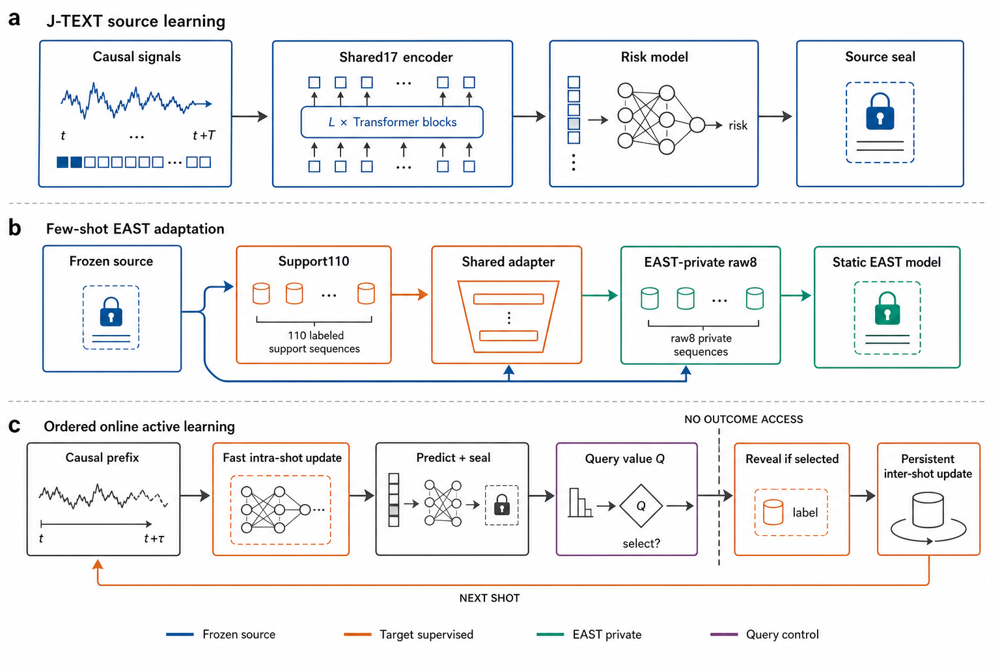

# J-TEXT → EAST: causal transfer and chronological online adaptation

**Language:** [简体中文（默认）](README.md) · **English**

[Paper-v3c Chinese technical report](experiments/transfer_methods_2026/paper_grade_package/TECHNICAL_REPORT_zh.md) · [AdvancedTime dynamic-label appendix](experiments/transfer_methods_2026/paper_grade_package/DYNAMIC_MAINLINE_TECHNICAL_REPORT_zh.md) · [Data contract](DATA_CONTRACT.md)

   
  



This repository packages one auditable development chain:

```text
J-TEXT TRAIN1353 source model
-> EAST support110 few-shot transfer
-> sealed EAST balanced360 static replay
-> reset to the identical transferred parent
-> chronological online-active replay on balanced360
```

J-TEXT TEST220 also has an independent online diagnostic branch. Its online state is never used to initialize EAST transfer. Shot outcome and disruption time are authoritative only in HDF5 `/meta/IsDisrupt` and `/meta/DownTime`.

> Evidence boundary: all results are `TEST_DRIVEN_EXPLORATION`. TEST220 and balanced360 were inspected during method development; they are not independent future confirmation cohorts or deployment evidence.

## Current results

Equal-weight means across seeds 131, 133, and 137 are shown below. Operational TPR requires lead `>10 ms` on J-TEXT and `>=30 ms` on EAST.

| Stage | TPR | FPR | AUC | J = TPR - FPR |
|---|---:|---:|---:|---:|
| Original J-TEXT source TEST220 | **0.851515** | **0.212121** | **0.921928** | **0.639394** |
| EAST static transfer balanced360 | **0.840741** | **0.166667** | not reported | **0.674074** |
| Original EAST v3c online balanced360 | **0.848148** | **0.151852** | not reported | **0.696296** |

In the sealed original paper-v3c lineage, online adaptation increases TPR@30 by `0.007407` and reduces FPR by `0.014815`, giving mean delta-J `+0.022222`. Across the three model seeds it adds four timely detections and removes eight false alarms; query counts are `102/90/99`. These are development-stream results, not independent future confirmation.

The later AdvancedTime dynamic-label rerun (`0.824074/0.142593` static and online) is retained as a separate appendix and must not replace the original v3c headline. The newly added J-TEXT online branch is also isolated and never initializes EAST transfer.

Paper-v3c is the repository headline lineage. The AdvancedTime dynamic-label rerun and the isolated J-TEXT online branch are appendices with different checkpoints and must not be merged into the paper-v3c averages.

## Label and method contract

For disruptive J-TEXT shot `s`, the positive horizon is `max(25 ms, AdvancedTime_s)`, with a 25 ms fallback. AdvancedTime changes only the positive-window boundary; it cannot override HDF5 outcome or DownTime. EAST support110 retains its fixed 125 ms target label. The selected arm is `source_dynamic__east_fixed`.

- The source is a causal `128 x 17` Transformer trained on TRAIN1353; VAL160 locks checkpoint and threshold before TEST220 access.
- Cross-device shared17 uses the source median/IQR scaler. Eight EAST-private signals enter a bounded target-only residual branch instead of forced semantic alignment.
- EAST support110 adapts high target layers and an independent EAST risk head. The J-TEXT online state is forbidden as a transfer parent.
- Intra-shot updates use only arrived endpoints and modify a disposable fast state. Persistent updates happen only after prediction sealing, query selection, and label reveal.
- Active and causal-random J-TEXT controls use identical query counts, optimizer attempts, windows, replay volume, and reported FLOPs.

## Reproduction

Use the CUDA-enabled `rl_env` environment:

```bash
export FUSION_DATA_ROOT=/absolute/path/to/data
PY=${CONDA_PREFIX}/bin/python
$PY -c 'import torch,h5py; print(torch.__version__, torch.cuda.is_available(), torch.cuda.get_device_name(0))'
```

CPU CI installs only audit dependencies and does not replace GPU replay:

```bash
uv sync --frozen --only-group ci --no-install-project
```

Keep the GPU development environment inside the active Conda environment:

```bash
UV_PROJECT_ENVIRONMENT="$CONDA_PREFIX" uv sync --frozen --extra dev
export FUSION_PROJECT_ROOT="$PWD"
```

Run one formal seed with:

```bash
$PY experiments/transfer_methods_2026/run_selected_full_mainline.py --seed 131 --stage all --data-root "$FUSION_DATA_ROOT" --output /ext4/runs/selected_full_mainline/seed131
```

Repeat for seeds 133 and 137. Then run evidence assembly, report generation, and the test suite using the scripts under `experiments/transfer_methods_2026/paper_grade_package/scripts/`.

`fusion-reproduce` is an editable-checkout CLI, not a standalone wheel; it still needs repository configs, rosters, and scripts under `FUSION_PROJECT_ROOT`.

## Evidence and limitations

The portable evidence object is [dynamic_mainline_report.json](experiments/transfer_methods_2026/paper_grade_package/evidence_dynamic/dynamic_mainline_report.json), SHA-256 `35915b782b6c247ff768e643d02d370f4776586fab10ce54f9f8c1305a9cdbff`. It binds 80 input artifacts and records `summary_metrics_used=false`.

The engineering chain is executable and hash-auditable. Scientific admission is not achieved: EAST transfer remains below the registered three-seed gate, J-TEXT active selection does not outperform equal-compute random querying, and an independent future chronological stream is still required.

License: [MIT](LICENSE). Citation metadata: [CITATION.cff](CITATION.cff).
