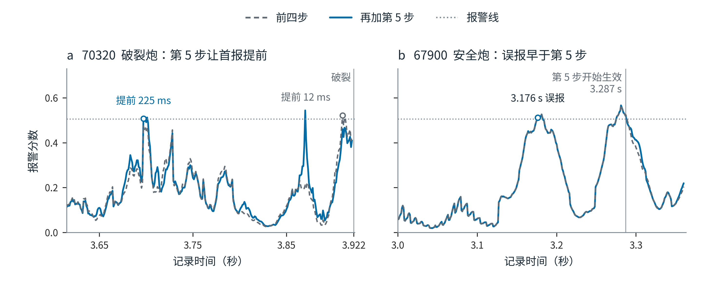

# 让 EAST 在破裂前多留一点反应时间

**从 J-TEXT 训练到 EAST 逐炮回放｜技术方案底稿**  
2026-11-14 · [实验明细和逐炮证据](EAST360_TECHNICAL_EVIDENCE_20261114.md)

> 在 EAST 的 360 次历史放电回放里，180 次破裂中有 **146 次及时报警（81.11%）**，180 次未破裂放电中有 **34 次误报（18.89%）**。只关掉最后一步炮内修正，及时数是 144，误报仍是同样的 34 次。**最后一步独立增加的是 2 次及时报警。** 把同一套方法放到另外 2,593 次历史放电上，误报率升到 27.56%。目前已经有可复现的预警原型；下一阶段要用新炮检验它能否达到现场要求。

## 1. 我们争取的是反应时间

[EAST](https://english.cas.cn/research/platforms/large-research-infrastructures/energy/east/) 用磁场约束高温等离子体。一次放电简称一炮。如果等离子体突然失稳，磁约束迅速减弱或丧失，就可能发生破裂。破裂会给装置带来热负荷和机械载荷，提前报警的价值是给保护系统争取时间。[ITER 对破裂及其缓解的说明](https://www.iter.org/machine/supporting-systems/disruption-mitigation)

拿 70320 炮来说，它在 3.922 秒破裂。如果模型直到 3.910 秒才报警，只剩 12 毫秒；如果 3.697 秒就报警，就剩 225 毫秒。这两个版本都报了警，给保护系统留下的时间却相差 213 毫秒。反过来，如果一炮没有破裂，却先触发了警报，那就是误报。方案必须同时回答两件事：**哪些破裂报得够早，多少未破裂的放电被误报。**

## 2. 系统拿什么判断，怎样从 J-TEXT 用到 EAST

J-TEXT 和 EAST 是两台不同的聚变实验装置。我们先用 J-TEXT 的历史放电训练一个基础模型，让它学会从一小段信号计算破裂风险。已有跨装置研究表明，先把两台装置的诊断整理成可比较的量，再做适配，是一条可行路线。我们进一步问：到了 EAST，当前炮的破裂结局还不知道时，能不能用刚收到的仪器读数改进这炮自己的预警？[跨装置研究，Shen 等](https://arxiv.org/abs/2309.05361)

现在能读到的是每毫秒一个点的 **23 路诊断序列**，例如电流、环电压、反映位置变化的读数、磁扰动和辐射统计。其中磁扰动的幅值和频率已经提取好，高速线圈波形不在文件里。主方法按时间顺序读这些值，用训练时确定的中心和尺度换算，对缺测另加标记，不再对输入做傅里叶变换。基础网络每次接收最近 **128 个点**，每 **8 点**整理成一小段。评分公式会综合这些小段和本炮较早形成的误差记录。开头不足 128 点时，用缺测标记补齐历史长度，报警仍可发出。

工程上有三个时段。**第一，离线准备。** 用 J-TEXT 训练基础模型和诊断预测器。**第二，EAST 准备段。** 回放的前 20 炮先按原模型发出并保存报警；20 炮全部结束后，才用这批诊断和结局准备后续使用的输入尺度、报警评分公式和阈值。**第三，EAST 第 21–360 炮。** 基础网络和准备好的评分公式冻结。每炮重新开始，用本炮已到达的读数更新临时状态；炮结束就丢掉这些状态。另有用已结束炮结局更新后续炮的试验，单独比较。

> **信号到达 → 给当前时刻打分，同时定期预测接下来 25 个点 → 等实测到齐 → 用预测误差修正本炮后续打分 → 炮末清空临时状态。**

这里有两种不同的输出：**风险分数**决定现在报不报警；**诊断预测**是对未来仪器读数的估计，用来在实测到齐后产生反馈。预测值不替代仪器实测，破裂结局也不会写回本炮已有的报警记录。

## 3. 第 5 步具体做了什么

模型每隔 32 个点发出一次诊断预测，一次预测接下来 25 个点。实测到齐后，把这 25 点分成五段，保留每段预测偏高还是偏低的信息。再减去发出预测时已经能从本炮历史估计出的常见误差。这样，持续猜高一点和突然猜错走势，给模型的反馈不同。

这笔反馈只调整**第一层注意力之前的临时系数**。注意力层会比较各小段信号；我们让相邻两个小段的内部表示一边减、另一边加同样的量，改变它们之间的差别。系统先把诊断预测误差换算成内部需要改变的方向，再计算当前窗口里该调哪些临时系数。基础网络的权重和报警线保持固定。试验给最新和较早误差相同的实际改动幅度，由此比较两笔误差给出的方向是否有用。[模型内部变化、预测和实测](outputs/east360_row5_70320/70320_mechanism.pdf)

图 1｜两炮共用同一报警线。空心点标首报。左图竖线是实际破裂，右图竖线是第 5 步第一次实际改变模型。横坐标沿用数据文件的记录时钟。

**70320：哪一笔实测让报警提前？** 模型在 **3.639 秒**发出预测，实测在 **3.640–3.664 秒**陆续到齐，**3.665 秒**起才允许使用这笔误差。其中一路位置代理先低于预测，后半段又高于预测。额外等 5 个点后，系统在 **3.670–3.678 秒**交接新旧修正；3.671 秒开始混入新修正，3.678 秒完成交接。到了 **3.697 秒**，前四步的分数是 **0.4742**，加入第 5 步后为 **0.5077**，刚过 **0.5062586** 的报警线。同样大小的调整若改用上一笔较早误差，此时只有 **0.4601**。这次早报确实随误差来源改变，但首次越线只持续一个采样点；要求连续两点越线时，这一炮不再算及时。

**67900：为什么第 5 步没赶上误报？** 这炮的信号记录约 5 秒，整体并不短。只是 **3.176 秒**误报时，记录从 3.000 秒起才过去 176 毫秒。3.127 秒的第一笔预测缺少足够的历史参照。3.159 秒发出的那笔才具备参照条件，实测到 **3.184 秒**才齐。第 5 步还需要几笔已完成的误差作比较；到 **3.255 秒**发出的那笔预测，才具备全部写入条件。它的误差从 **3.281 秒**允许使用，额外等 5 点后从 **3.286 秒**开始交接，下一点 **3.287 秒**才改变模型。第 2 行在 3.281 秒已经误报，第 3 行把同一炮的首报推到了 3.176 秒。第 5 步只能改变之后的分数。

**多等 5 点有什么用？** 它推迟的是新旧修正的交接，报警一直照常进行。70320 等不等都是 3.697 秒首报；安全炮 **73743** 不等时在 **4.698 秒**误报，等 5 点后同一时刻分数从 0.5329 降到 0.3445，整炮未过线。完整 360 炮的及时炮号没变，少了这 1 次误报。这个结果说明交接时点会影响首报，现场实际延迟仍要测量。[73743 与等待对照](outputs/east360_row5_70320/70320_alarm_and_wait.pdf)

## 4. 全部 360 炮怎么计分

回放固定为 **180 炮破裂、180 炮未破裂**。一炮只按首次越线计分：破裂前**严格超过 30 毫秒**才算及时，恰好 30 毫秒算晚报；未破裂炮只要有一次越线就算误报。主目标是误报不超过 **36/180（20%）**，在此条件下尽可能多地报对破裂。选 30 毫秒是本项目的评价约定。训练时用来告诉模型哪些点靠近破裂的时间窗，是另一回事。

下表每一行都保留上一步的处理，只增加所列动作。**136 炮这一行已经完成前 20 炮准备**，只是关闭了炮内修正。它和只用 J-TEXT 源模型直接跑 EAST 的版本不同。**144 炮这一行已有前四步**，所以它才是衡量第 5 步独立贡献的对照。

| 累加步骤 | 这一步新增什么 | 及时检出／180 | 误报／180 |
|---|---|---:|---:|
| 0 · 准备后静态 | 用固定的输入处理和评分公式，一炮内不修正 | 136（75.56%） | 32（17.78%） |
| 1 · 记录本炮预测偏差 | 用本炮已完成的预测误差形成一份短期记录，让评分公式知道模型最近猜得偏高、偏低，或把走势估错了 | 138（76.67%） | 31（17.22%） |
| 2 · 比较这笔误差与本炮常态 | 按电流、磁场等当时可见的运行条件找相近的历史片段，把超出平常的误差另交给评分公式 | 141（78.33%） | 34（18.89%） |
| 3 · 修正输入中信号的相对走势 | 用已到齐的反馈，调整磁扰、位置、电压、辐射几组读数在模型输入中的前后关系 | 143（79.44%） | 34（18.89%） |
| 4 · 去掉一部分持续偏差 | 在送入模型的有效读数上做小幅平移，减去此前估计的持续偏差；原始记录不改 | 144（80.00%） | 34（18.89%） |
| 5 · 用最新误差修正第一层输入 | 保留前四步，只加第一层前的临时调整及其交接 | **146（81.11%）** | **34（18.89%）** |

从静态对照到完整方法，及时多 **10 炮（+5.56 个百分点）**，误报多 **2 炮**。其中第 5 步多报对 **70320**（12 → 225 毫秒）和 **73405**（29 → 33 毫秒）；前四步和加第 5 步误报的是同样的 34 炮。把最新误差换成较早误差且保持改动等大，结果为 **145 及时、35 误报**，也能救回 73405。两个救回案例里，只有 70320 清楚依赖这笔最新误差。这个差距不大，也会受单点越线规则影响。

如果汇报必须给一个总准确率，采用**“按时才算对”**：及时报警的破裂炮，加上从未报警的未破裂炮，再除以全部 360 炮。静态、前四步、完整方法分别是 **78.89%、80.56%、81.11%**。若把晚报也算对，这三行都是 **87.22%**，看不见模型把晚报变成及时的价值。完整方法还剩 **22 炮晚报、12 炮未报**。34 炮误报中，6 炮在准备段、7 炮在第 5 步初次写入之前、21 炮虽在第 5 步已经生效时越线，但关掉第 5 步整炮也会误报。[全 360 炮曲线](outputs/east360_row5_70320/EAST360_逐炮图谱.pdf) · [误报逐炮时间和分数](outputs/east360_row5_70320/EAST360_误报逐炮.csv)

## 5. 怎样避免回放提前看到答案

**先把炮序与模型看到的数据分开。** 这 360 炮按各炮开头 100 毫秒的电流读数，在历史库存中离线排定。准备样本 20 炮在前，其余 340 炮随后。回放顺序与真实采集顺序是两回事；模型按已定顺序打分，每次只使用本炮至当前点的信息。前 20 炮发出的报警照样计分，不能用准备好的模型倒回来重报。

**再把可学习的信息分开。** J-TEXT 固定分为 1,353 炮训练、160 炮验证、220 炮测试。训练历史用于拟合基础模型与辅助预测器；验证历史用于选模型与源阈值，测试只考核已定的源模型。EAST 准备用的是先保存预测、再揭示结局的前 20 炮（8 破裂、12 未破裂）。准备期间沿用 J-TEXT 报警线 **0.7258947**。准备结束后，将 12 个未破裂炮轮流留出，检查每炮最高分，用这些峰值确定后段共用的主报警线 **0.5062586**。同一阶段所有对照用同一条线；较严档 **0.6766528** 单独复核。主方法不用后 340 炮的结局再拟合或调阈值。炮间试验另有固定的历史标签预算，只能影响后来的炮。

**最后检查信号的可用时点。** 排序后的每一炮内部，模型只能看截至当前点的信号。25 个实测点到齐前不能计算对应误差；缺测不会用未来的值填。两炮首报附近实际重跑时，删除后续信号并未改变已经发出的越线判断。每炮是否破裂、何时破裂，以原始 HDF5 文件记录为准，不能用旧清单或事件表补猜。原 360 炮参与过方案比较，所以上述检查说明回放按时钟用数据，并不把这批炮变成独立未来样本。[结局与时间口径](HDF5_OUTCOME_CONTRACT_20261103.md) · [首报的截断复核](probe_outputs/commissioning_first_alarm_witness_east360_20261113_v1/prefix_at_first_alarm.json)

样本均衡也要分清训练与评分。360 炮的评价集本身两类各 180，原顺序、所有结果都保留。拟合准备段评分时，正、负时间点各分一半权重，同类里各炮等权，避免长炮因点数多而主导；炮间拟合则每次拿 1 个已结束破裂炮和 1 个已结束未破裂炮，各 8 点等权。波形预测用的是已观测到的数值，不能把没测到的点伪造成样本。历史扩展另外给出全量和 1:1 样本两种结果。[样本权重与各数据集去向](EAST360_TECHNICAL_EVIDENCE_20261114.md)

## 6. 炮间更新、频谱和大样本结果怎么写

**炮间更新用过去的炮帮助下一炮。** 在单独试验中，前 20 炮之后，每 20 炮最多揭示 1 个炮级结局，实际共揭示 16 次。在规定时点，用已结束的破裂和未破裂样本轻微调整“内部信息怎样换成风险分数”的公式。在已揭示结局的历史上检查这次修正：若新增误报、失去及时报警，或让某一炮新增超过 3 秒的过早报警，就撤掉修正。下文数字依次是及时检出与误报。主阈值下，前四步加炮间更新为 **145／38**；炮内和炮间同时开为 **147／38**，都超过 20% 误报上限。在原较严阈值下，单加炮间从 **119／23** 到 **121／24（13.33% 误报）**，这个有限收益成立；联合为 **120／26**，及时数未超过单加炮间。因此主方案保留炮内版本，炮间更新留作独立对照。[炮间完整对照](EAST_PHYSICS_CONDITIONED_ADAPTATION_DESIGN_20261111.md#47-固定16次标签的炮间回放较严阈值有增益同工况安全样本未改善误报)

**把波动提得更明显，安全炮也会一起涨分。** 用相同 8 路、相同 128 点、相同参数数量比较，加入时域特征是 **147／42**，加傅里叶频带特征是 **149／41**，均超限。随后尝试只有其他信号支持才允许傅里叶额外加分。只看电流，得到 **146／36**，4 个曾被傅里叶救回的炮全没保住；再看密度和磁探针，得到 **147／39**，只保住 92394。该炮的磁探针读数在早报前上升，未破裂的 74939 上升得更明显，两炮都通过了确认。两种确认分在整炮越线点上的排序都挡不住这种重叠，停止这条加分路线。[11 个相关炮逐一对照](outputs/east360_fourier_confirmation_20261114_v1/fourier_11_cases.csv)

**更大历史样本暴露出基础误报问题。** 把固定模型和阈值用于原 360 之外额外 **2,593 炮**：1,018 炮破裂，1,575 炮未破裂。原主阈值下，静态对照误报 **367／1,575（23.30%）**，已超限；前四步为 **697／1,018 及时、420／1,575 误报**，加第 5 步为 **706／1,018（69.35%）及时、434／1,575（27.56%）误报**。也就是多报对 9 炮，同时多误报 14 炮。抽成每类各 833 炮，完整方法误报仍是 **230／833（27.61%）**，不是单靠让两类一样多就能解决。较严阈值下，完整方法 **594／283**，比同背景多 6 炮及时，误报 **17.97%**；其代价是及时率降到 **58.35%**，而且没过该档原来检查的 15% 或 10% 上限。两批都是历史数据。较严档的收益不能替代原主阈值的跨样本结果。[扩展 2,593 炮与平衡结果](EAST_PHYSICS_CONDITIONED_ADAPTATION_DESIGN_20261111.md#41-原模型原阈值扩展到原360以外的全部本机east炮)

其它对照检验的是：**把波形猜得更准，能不能把报警也改对？** 现有试验没有显示出稳定关系。后段 33 个晚报或未报的炮，在破裂前 30–125 毫秒内都已有可用的更新机会。在一次从历史数据重学修正方向的试验中，许多炮的风险分数离报警线太远，实测带来的改动不足以让任何一炮在这段时间新越线。用更复杂的计算求修正、改变回看长度、找同一炮更早的相似片段，也都没有稳定提升主档。下一步优先检验**能否用更可靠的信号把真正持续恶化与正常工况变化分开**。[其它工程对照与适用范围](EAST360_TECHNICAL_EVIDENCE_20261114.md#4-其它路线解决了什么没解决什么)

## 7. 下一阶段需要什么证据

下一阶段先做**旁路验证**：把同一份现场数据送给原型，记录它会何时报警，报警不接入设备控制。第一步是分开记录采样、诊断量计算完成、模型收包、预测、修正写入和报警发出各个时刻。现在的 5 点是回放规则；只有把整条链路的延迟扣进去，才知道设备实际还有多少反应时间。若结果只靠一个点越线，还需要与现场确认规则一起复核。

第二步是先锁定当前版本、主阈值和炮级评分规则，再按真实采集顺序，用**从未参与选型**的新 EAST 放电验证。全量报告及时、晚报、未报和误报，再按工况补充。用同一批信号同时跑前四步与完整方法，检查完整方法在实测误报率不超过 20% 时，是否仍能多报出提前超过 30 毫秒的破裂炮。用现场收到报警的时间重新算提前量。现阶段缺的是一批独立新炮。

若现场能补采数据，优先要到**控制指令与实际反馈、多个视线的辐射信号、磁探针原波形和各字段实际到达时标**。这些数据能帮助检验某次变化是否由正常控制引起，或多个观测在实际时间上是否共同恶化。先做旁路数据核对和独立炮流验收；是否接入保护控制，是之后由装置方根据实测结果作出的决定。

## 写作与汇报顺序

开场可以直接这样讲：

> 「先看一次历史放电。它马上要破裂时，原先的做法留给保护系统 12 毫秒。让模型用刚收到的实测修正后，这次回放里留下了 225 毫秒。这个案例有用，但我们不能只挑报对的一炮。把 360 炮全部算进去，最后这一步让两炮从晚报变成及时，误报还是同样的 34 炮。换到更大的历史样本，误报却超限。接下来我讲这一步怎么做、为什么有时有效，以及正式接入设备前还要验证什么。」

| 听众此刻会问什么 | 放在正文里的答案 |
|---|---|
| 为什么值得做？ | 用 70320 的 12 与 225 毫秒引出“需要留出反应时间”，先不讲网络结构。 |
| 模型从哪里得到新信息？ | 画一条发出预测、等到实测、只改以后评分的时间线。用 67900 解释反馈还没到时怎么办。 |
| 到底多解决了多少？ | 先放 136、144、146 三个数字，带上对应误报；再用分步表交代 10 炮总收益和第 5 步的 2 炮增量。 |
| 增长能不能搬到别的炮？ | 同时给出历史扩展的 27.56% 误报，指出独立新炮和实际到达时标是下一阶段的验收材料。 |

书面正文按“要解决的问题 → 数据与方法 → 固定 360 的比较 → 适用范围与下一阶段”展开；实验分支、逐炮记录、模型内部尺寸放入附录。面对非本领域听众的口头汇报可按 8 分钟排：**1 分钟讲报警为什么要早，2 分钟走双炮图，2 分钟讲完整 360 的收益和代价，1 分钟讲大样本，2 分钟讲怎样验证下一阶段**。首轮只展示双炮图和主结果表；有人追问模型怎么改，再打开 [70320 内部数据图](outputs/east360_row5_70320/70320_mechanism.pdf)。
