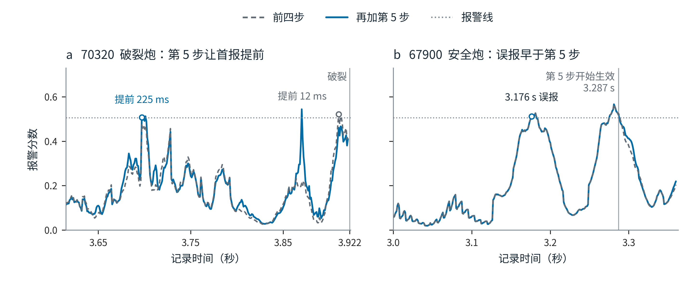

# EAST 360 炮在线适配：用刚到的实测，修正之后的预警

## 让 EAST 在破裂前多留一点反应时间

EAST 是一台用磁场约束高温等离子体的聚变实验装置，一次放电简称“一炮”。等离子体突然失稳、发生破裂时，装置可能承受很大的热负荷和机械载荷。预警的价值不仅是“报没报”，更是**能否给保护系统留出时间，同时少误报正常放电**。

本研究先用另一台装置 J-TEXT 的历史数据训练模型，再让它适应 EAST。关键想法是：**先预测接下来的仪器读数，等实测到达后，利用猜错的地方修正本炮后续的判断。** 当前炮还没有结束，不需要提前知道它会不会破裂。

> **360 炮历史开发回放：** 及时检出 **146/180（81.11%）**，误报 **34/180（18.89%）**。相对准备后的静态基线，前四步净增 **8 炮及时**，第 5 步再增 **2 炮及时**。  
> **扩展到另外 2,593 炮：** 完整方法误报率 **27.56%**，超过 20% 上限。当前方法在 360 炮上有实测增益，大样本主阈值未达标。

研究结果更新至 **2026-11-14**；README 整理于 **2026-11-15**。

[方法怎样工作](#方法怎样工作) · [逐步贡献](#每一步贡献多少) · [双炮曲线](#70320和67900一炮早报一炮误报) · [大样本与局限](#换到更大样本为什么还不能说成功) · [代码与证据](#查看代码曲线和实验记录)

## 方法怎样工作

### 先训练，再准备 EAST，最后逐炮运行

1. **J-TEXT 离线训练。** 一个基础网络根据近期信号判断风险；一个辅助预测器估计未来仪器读数。两种输出分开：风险分数决定是否报警，读数预测用来在实测到齐后产生误差。
2. **EAST 前 20 炮准备。** 这 20 炮有 8 炮破裂、12 炮未破裂。先用原模型预测并保存，全部结束后，才对齐密度读数 `ne_nG` 的尺度、拟合 EAST 评分公式并确定后段阈值。**前 20 炮仍计入总成绩，不用准备后的模型倒回去重报。**
3. **EAST 后 340 炮运行。** 基础网络与评分公式冻结，每炮只用截至当前点的信号和已到齐的实测误差做临时修正。炮结束后清空临时状态；下一炮重新开始。

每毫秒到一个新点，模型看最近 **128 点、23 路诊断**，例如电流、环电压、位置、磁扰动和辐射。开头不满 128 点或中间缺测，就标记缺失，不用未来读数补齐。输入包含已提取的磁扰动统计量；**主方法不额外做傅里叶变换**。

```text
每个新点到达 → 用已到信号给当前时刻打分 → 越过固定报警线就报警
                     ↑
每隔32点预测未来25点 → 等25点实测到齐 → 算误差 → 只修正之后的打分
```

**主报警线从哪里来？** 前 20 炮沿用源阈值 **0.7258947**。准备结束后，对 12 个未破裂炮做留一检查：每次用其余 19 炮拟合评分，再记录留出炮的整炮最高分。主线设在这些峰值的第二高值略上方，为 **0.5062586**。后 340 炮所有主表对照共用这条线，不按各炮结局改线。较严的 **0.6766528** 只用于单列核对，不混入主成绩。

### 前四步处理评分和输入，第 5 步处理网络内部

“步骤”表示**累加开启的处理模块**，不是要求同一炮必须依次等五步结束才报警；报警始终进行。

- **第 1 步：记住最近猜错在哪里。** 实测到齐后，记录整体猜高、猜低以及误差的走势。评分公式多读取这份本炮短期记录，仪器读数的输入方式还没改。
- **第 2 步：区分常见误差和这次的异常误差。** 用同一炮较早、运行条件相近的片段估计平常的误差，再把这笔误差超出平常的部分交给评分公式。最近两笔误差方向一致时，提示的分量更大。
- **第 3 步：修正送入网络的信号走势。** 用到齐的反馈，调整磁扰、位置、电压、辐射几组信号在已观测窗口里的前后关系。只改输入副本的形状，不改原始记录或时间，也不访问窗口之后的读数。
- **第 4 步：扣掉反复出现的整体偏差。** 若某路实测总比预测高一点，就估计这个差值，在幅度限制内，从这路输入副本的有效点扣掉同样多。**第 3 步改走势，第 4 步改整体高度。**
- **第 5 步：让最新误差改变网络内部怎样比较时间段。** 前四步照常，只在第一层注意力之前加入临时修正；基础权重、风险评分公式和报警线不动。误差能使之后的分数升高，也能使它降低。

<details>
<summary>想看模型具体改在哪里：60 个临时系数，而不是重新训练整个网络</summary>

基础网络 `Simple23` 有两层 Transformer。128 点按每 8 点分成 16 个时间块，每块换成 64 维内部表示，注意力层再比较这些块。

第 5 步把 25 点预测与实测每 5 点分一段，保留五段里误差的正负和走势，再减去本炮此前已到齐的常见误差。反馈来自八路读数，归为磁扰、位置、环电压、辐射四组；把误差换成修正方向的规则在 J-TEXT 历史上拟合。

16 个块形成 15 对相邻块，每对每组有一个临时系数，共 **15×4=60 个**。系统用误差算出内部表示应朝哪个方向变，再用当前已观测窗口求出这些系数。相邻块一边加、一边减同样的量，改变段间差别；实际改动幅度受限。后续网络读取改变后的表示，给出新的风险分数。

误差可用后，主版本**额外等 5 点**，再在 8 个采样间隔内逐渐交接新旧修正。等待只延后修正生效，期间照常预测和报警；炮末清空这些系数。[实际写入代码](experiments/risk_aligned_online/commissioning_group_token_20261112.py) · [等待与回放代码](experiments/risk_aligned_online/commissioning_write_delay_20261112.py)

</details>

### 炮内和炮间不能混算

**炮内更新用本炮已到的实测，改本炮之后的判断；炮间更新用已经结束的炮，改后续炮。** 主结果采用前四步加第 5 步，不叠加准备段之后的炮间标签更新。

另做的炮间对照在本炮预测封存、炮结束后才按预算揭示结局，共 16 次；每次用已揭示的一破裂炮、一未破裂炮，各取 8 点等权，调整后续风险评分。前四步加炮间为 **145 及时、38 误报**；再加第 5 步为 **147 及时、38 误报**。两组误报均为 **21.11%**，超过主上限，未替代当前方案。

## 每一步贡献多少

固定 **360 炮：180 破裂、180 未破裂**。每炮只看首报：破裂前提前量**严格大于 30 ms**才算及时，恰好 30 ms 也算晚报；未破裂炮只要越线一次就算误报。目标是在误报 **≤20%（最多 36 炮）** 时提高及时检出。

下表每行保留上一行，只增加所列处理；成员、炮序、准备段预测和同阶段报警线相同。增量是配对回放的**净变化**，不是不同数据集的成绩。

| 累加处理 | 及时检出 / 180 | 误报 / 180 | 比上一行：及时 / 误报 |
|---|---:|---:|---:|
| 0 · 准备后静态，关闭炮内修正 | 136（75.56%） | 32（17.78%） | — |
| 1 · 评分读取本炮近期误差 | 138（76.67%） | 31（17.22%） | +2 / −1 |
| 2 · 评分再读取超出平常的误差 | 141（78.33%） | 34（18.89%） | +3 / +3 |
| 3 · 修正输入的前后走势 | 143（79.44%） | 34（18.89%） | +2 / 0 |
| 4 · 输入再扣除持续整体偏差 | 144（80.00%） | 34（18.89%） | +1 / 0 |
| **5 · 最新误差修正第一层内部表示，等 5 点** | **146（81.11%）** | **34（18.89%）** | **+2 / 0** |

**前四步合计：** 相对静态净增 **8 炮及时（+4.44 个百分点）**、净增 **2 炮误报（+1.11 个百分点）**。144 这一行已有炮内处理，**不是静态基线**。第 3 步虽然误报总数不变，实际去掉一炮、又新增一炮。

**第 5 步独立贡献：** 将 **70320、73405** 从晚报改为及时，净增 **2 炮（+1.11 个百分点）**，误报仍是同样的 34 炮。完整方法相对静态共多 **10 炮及时**，不是这 10 炮都由第 5 步救回。

按“及时的破裂炮 + 未误报的未破裂炮”除以 360，总体准确率依次为：**静态 78.89% → 前四步 80.56% → 完整 81.11%**。完整方法另有 **22 炮晚报、12 炮未报**。若晚报也算对，三者准确率都为 **87.22%**，看不出提前报警的价值。

[完整 13 行计分与准确率](outputs/east360_row5_70320/EAST360_完整计分.csv) · [逐炮翻转及误报名单](EAST360_TECHNICAL_EVIDENCE_20261114.md#2-每一行对照多了什么改了哪些炮)

## 70320和67900：一炮早报，一炮误报



灰虚线为前四步，蓝线再加第 5 步，水平点线为同一报警线。左图竖线是破裂时刻，右图竖线是第 5 步首次实际改动。曲线取自封存回放，不是示意数据。

### 70320：3.639 秒预测，实测到齐后才改，3.697 秒早报

模型在 **3.639 s** 发出对 **3.640–3.664 s** 的预测；实测逐点到齐后，从 **3.665 s** 才允许计算整笔误差。有一路位置读数前半段低于预测、后半段又高于预测，分段误差保留了这种转向，不让一高一低在整体均值中抵消。

等 5 点后，**3.670 s** 开始交接，**3.671 s** 混入新修正，**3.678 s** 完成交接。到 **3.697 s**，前四步分数 **0.47423**，完整方法 **0.50769**，刚越过 **0.5062586**。改变的是网络看到的段间差别，报警线没移动。

该炮在 **3.922 s** 破裂。前四步 **3.910 s** 首报，只提前 **12 ms**；第 5 步后 **3.697 s** 首报，提前 **225 ms**，多出 **213 ms**。用同样幅度但较早的误差，此时分数为 **0.4601**，未越线：这个案例显示最新实测的方向确实影响了早报。

**限制也要看：** 70320 首次仅一个点越线；要求连续两点确认时，它不再算及时。另一新增及时炮 73405 从 **29 ms → 33 ms**，只比及时界线多 3 ms，而且较早误差对照也能救回它。

### 67900：3.176 秒已经误报，3.287 秒才首次改动

67900 **没有破裂**，但两个版本都在 **3.176 s** 误报。第 5 步首次实际改动在 **3.287 s**，晚了 **111 ms**，后到反馈不能撤销已发出的警报。

**不是整炮太短，而是报警来得太早、反馈条件还没凑齐。** 这炮记录约 5 秒，从 **3.000 s** 开始；误报时只经过 176 ms。**3.127 s** 的首笔预测缺足够的历史参照。**3.159、3.191、3.223 s** 的合格预测逐步积累参照，到 **3.255 s** 发出的那笔才满足最新/较早误差公平对照的共同写入条件。它的实测 **3.280 s** 收齐，**3.281 s** 允许用误差，再等 5 点并交接，下一点 **3.287 s** 才实际改变模型。

分步回放中，第 2 步使这炮在 **3.281 s** 误报，第 3 步又把首报提前到 **3.176 s**。这个错例说明，早期评分和输入修正本身也需要改进，不能把问题全归给最后一步。

**多等 5 点的实测作用：** 70320 等不等均在 3.697 s 首报；未破裂炮 **73743** 不等时在 4.698 s 误报，等后整炮未报。360 炮中，等待使 **146 及时 / 35 误报 → 146 / 34**，及时炮号不变；这一交接效果仍需按现场实际延迟验证。

[双炮绘图数据 CSV](outputs/east360_technical_20261114/two_shot_curves.csv) · [Python / seaborn 脚本](outputs/east360_technical_20261114/plot_two_shots.py) · [矢量 PDF](outputs/east360_technical_20261114/two_shot_timelines.pdf) · [70320 实测与内部变化](outputs/east360_row5_70320/70320_mechanism.pdf)

## 怎样防止提前看到答案，怎样做样本均衡

- **按到达时点用数据。** 当前判断只能用当前及更早的读数；25 点实测到齐前不能训练这笔反馈；临时状态炮末重置。预测封存后，炮结束才揭示结局。主方法不拿后 340 炮结局重新拟合评分或阈值。
- **训练、准备与评分分开。** J-TEXT 固定分为 1,353 炮训练、160 炮验证、220 炮测试；训练拟合模型，验证选择源模型与阈值。EAST 只有前 20 炮用于准备后段运行；原预测保留。
- **结局只认原始 HDF5。** `meta/IsDisrupt` 判断是否破裂；只有破裂炮的 `meta/DownTime` 用作破裂时刻，不从炮表或事件表补判。EAST 破裂前 **125 ms** 是训练正窗，**>30 ms** 是及时评分规则，二者不同。
- **训练不让长炮或多数类占便宜。** 准备段评分拟合中，正负时间点各分一半权重，同类内按炮等权；炮间对照每次正负各一炮、各 8 点等权。完整评价保留两类各 180 炮，所有错例都计入。

两例新增及时炮的首报已做截断重放：删掉首报之后的信号，已有判定不变。[截断检查记录](probe_outputs/commissioning_first_alarm_witness_east360_20261113_v1/prefix_at_first_alarm.json)

**数据限制：** 360 炮已参与方法开发和选型，上述因果访问检查不会使它变成独立测试集。固定回放顺序也不等于已认证的真实采集日期顺序；上游诊断计算和现场数据到达时标尚未独立认证。

## 换到更大样本，为什么还不能说成功

额外 **2,593 炮历史放电**包含 1,018 炮破裂、1,575 炮未破裂，沿用原模型和主阈值，未为扩展样本重新拟合。

| 相同主阈值的扩展对照 | 及时检出 / 1,018 | 误报 / 1,575 |
|---|---:|---:|
| 准备后静态 | 695（68.27%） | 367（23.30%） |
| 前四步 | 697（68.47%） | 420（26.67%） |
| 完整方法 | 706（69.35%） | 434（27.56%） |

第 5 步净增 **9 炮及时**，也净增 **14 炮误报**，没有满足“误报 ≤20% 下提高及时检出”的主要求。静态误报已达 **23.30%**，说明问题不只在第 5 步。抽成两类各 **833 炮**后，完整方法仍误报 **230/833（27.61%）**，不是把类别数量配平就能解决。

回到 360 炮，34 个误报中，**6 炮在准备段、7 炮在第 5 步首次实际改动之前、21 炮在其生效后**；最后这 21 炮关掉第 5 步也会误报。完整方法没有新增误报炮，但个别首报时刻会变化。[误报逐炮时刻、分数与分类](outputs/east360_row5_70320/EAST360_误报逐炮.csv)

其它扩展也没有替代主方法：在同一 360 炮上，时域特征为 **147 及时 / 42 误报（23.33%）**，傅里叶频带为 **149 / 41（22.78%）**；加入其它信号确认后，电流确认 **146 / 36（20.00%）**、三诊断确认 **147 / 39（21.67%）**。没有同时增加及时并保持误报在上限内，当前方案不加入这些分支。[完整负结果与对照](EAST360_TECHNICAL_EVIDENCE_20261114.md#4-其它路线解决了什么没解决什么)

较严阈值和连续确认的核对也保留在[实验明细](EAST360_TECHNICAL_EVIDENCE_20261114.md#3-第-5-步的模型动作时钟和敏感性)，不拿较低误报档替换主阈值结论。扩展炮也是历史数据，仍缺**从未参与选型的新 EAST 炮流**和**现场实际延迟**。下一阶段应先冻结版本，在新炮上只记录、不接管设备，同时比较前四步与完整方法。

## 查看代码、曲线和实验记录

想看研究本身，不需要 GPU：

- **看方案与讲解：** [技术方案](EAST360_TECHNICAL_PROPOSAL_20261114.md) · [可直接照着讲的汇报稿](EAST360_TECHNICAL_TALK_20261114.md)。
- **看全部炮，而不只看两个案例：** [360 炮曲线图谱，约 64 MB](outputs/east360_row5_70320/EAST360_逐炮图谱.pdf) · [计分 CSV](outputs/east360_row5_70320/EAST360_完整计分.csv) · [误报 CSV](outputs/east360_row5_70320/EAST360_误报逐炮.csv)。
- **看代码：** [前四步输入与内部计算入口](experiments/risk_aligned_online/commissioning_layer_transport_20261112.py) · [第 5 步系数与误差](experiments/risk_aligned_online/commissioning_group_token_20261112.py) · [等待和回放](experiments/risk_aligned_online/commissioning_write_delay_20261112.py)。
- **查完整实验：** [实验明细](EAST360_TECHNICAL_EVIDENCE_20261114.md) · [工程实验总账](EAST_PHYSICS_CONDITIONED_ADAPTATION_DESIGN_20261111.md) · [当前研究状态](CURRENT_SOURCE_UPDATE_STATE_20261104.md)。

```bash
git clone --branch research/east360-online-adaptation \
  https://github.com/rikfish163-rgb/tokamak-final.git
cd tokamak-final/research/east360-online-adaptation
```

已有 NumPy、matplotlib、seaborn 的环境可从打包数据重画双炮图：

```bash
python outputs/east360_technical_20261114/plot_two_shots.py
```

使用项目现有 `rl_env` 可运行 CPU 定向测试：

```bash
PYTHONDONTWRITEBYTECODE=1 CUDA_VISIBLE_DEVICES='' python -m pytest -q -p no:cacheprovider \
  tests/test_commissioning_write_delay_20261112.py \
  tests/test_commissioning_group_carry_20261112.py
```

**完整模型重放还需要外部资产。** 原始 HDF5、模型权重和输入缓存未随 Git 上传；原路径与封存协议列在[外部资产说明](EXTERNAL_ASSETS.md)。已有曲线和成绩可直接查看，不能把读取这些文件称为一次新的模型实验。[同步清单](SYNC_MANIFEST.json) · [同步核对记录](SYNC_VALIDATION.md) · [MIT 许可证](../../LICENSE)

本研究是 **J-TEXT 基础模型 → EAST 准备段 → 逐炮炮内适配**。旧 support110／V3C 另有分集、处理和阈值，保留为历史资料，成绩不混报。
